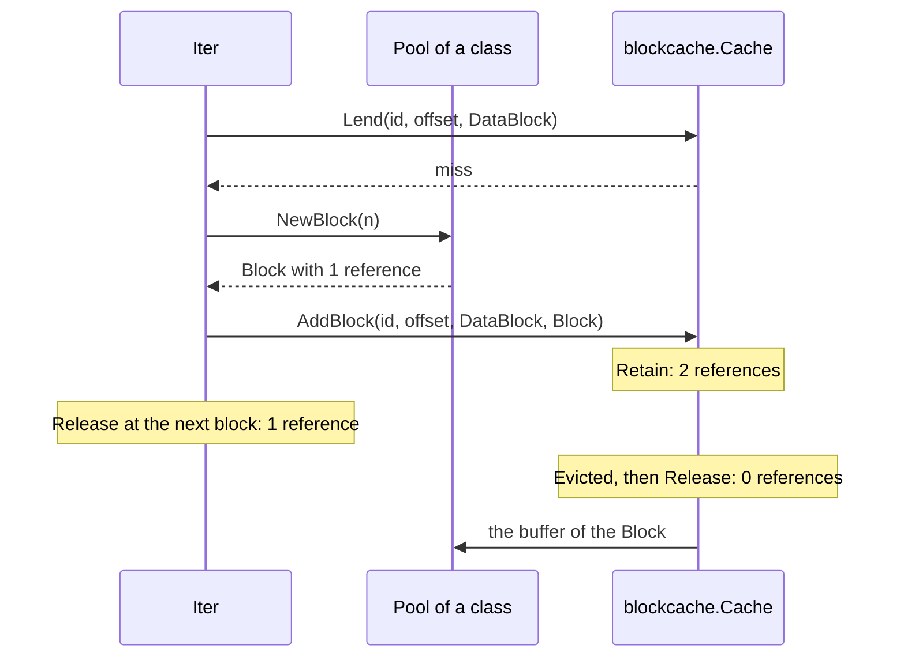

<!--
  ~ Copyright ThesmOS B.V. 2026
  ~ SPDX-License-Identifier: Apache-2.0
-->

# RFC-0075: Blocks That a Cache Lends to Readers

## Summary

A `sstable.Reader` adds a new copy of each block that misses its
`BlockCache`, so every miss allocates a buffer of the size of the block. We
propose four additions:

- `sstable.Block` is a buffer of a decoded block that counts its
  references. Its last `Release` returns the buffer to a pool of size
  classes.
- `sstable.BlockRole` is the role of a block in its table: a data block, an
  index partition or a filter partition.
- `sstable.LendingCache` is a `BlockCache` that keeps `Block`s and lends
  each one to a reader with a reference. Each call receives the role of its
  block.
- Package `sstable/blockcache` implements `LendingCache` over `cache.Cache`.
  It issues the identities of the tables that share a cache.

A Reader whose cache implements `LendingCache` copies a block that misses
into a pooled `Block` and adds that `Block`. Each cursor keeps a reference
to the block of its current entry. A miss through `blockcache.Cache` then
allocates the entry of the cache and no block.

## Motivation

### Each miss allocates a block

`Iter.load` adds `bytes.Clone(b)` to the cache for each block that misses,
and `Reader.Get` reads through `Iter.load`. The cache evicts the copy
later, and the garbage collector frees it.

A probe measured the cost on a table of 4,096 entries of 1,000 bytes in 820
blocks of about 5 KB. The table was behind a `cache.Cache` of a quarter of
its size, which costs each block by its length. A walk of the table misses
every block, and so does a `Get` of the keys in the order of a permutation.
Each figure is the median of 12 runs in rotating order, on one thread of an
AMD Ryzen 9 9950X3D with Go 1.27.2:

| Read | Time | Allocations | Bytes |
|---|---|---|---|
| A walk that fills a cache of copies | 615.7 µs | 1,646 | 4.31 MiB |
| A walk under `NoFill` | 192.1 µs | 0 | 0 |
| A `Get` that fills a cache of copies | 1,024 ns | 2 | 5,392 |

Each miss allocates the copy of the block and the entry of `cache.Set`. The
walk that fills the cache takes 3.2 times the time of the walk under
`NoFill`.

### A pooled buffer needs an owner

A pool lends a buffer for the next block once the buffer returns. A reader
that still reads the earlier block then reads the bytes of another block.
`BlockCache.Get` returns a slice without a pin, so the cache does not know
when the last reader of a block is done with it.

`cache.Cache` already has the parts of an owner. A `Pin` of an entry that
has left the cache fails (`cache/cache.go:195`). `Config.Evicted` receives
an entry that left while pinned at its last `Unpin` (`cache/cache.go:38`).

### A cache counts the roles of its blocks together

A Reader of a table of format version 2 (RFC-0077) looks up its filter
partitions, its index partitions and its data blocks through the same calls
of its cache. A cache that counts its lookups then counts the three roles
together.

A probe wrote a table of 65,315,331 bytes of 100-byte values. The table has
data blocks and partitions of 4 KiB. The probe read it through a
`blockcache.Cache` of 8 MiB. It warmed the cache with 200,000 `Get`s of
random keys and counted the lookups of 200,000 more:

| Lookups | Hits | Misses | Hit ratio |
|---|---|---|---|
| Data blocks | 19,877 | 180,123 | 9.9% |
| Partitions | 399,988 | 12 | 100.0% |
| All | 419,865 | 180,135 | 70.0% |

Each `Get` looks up a filter partition, an index partition and a data block.
The partitions fit the cache, so the hit ratio of all lookups is 70%. Of the
data blocks, 90% come from the file. A consumer can tell a data block from a
partition by its offset only when it knows where the data blocks of each
table end. It cannot tell an index partition from a filter partition by its
offset.

### Tables of one identity read the blocks of each other

The readers of different tables that share a cache need different
identities. A consumer has to keep a source of identities beside each
cache. A Reader checks the CRC32C of each block that it reads from its File,
and not of a block that the cache returns.

A probe wrote two tables of one key `k`. The value of `k` is `a` in the
first table and `b` in the second. The probe opened both behind one
`blockcache.Cache` under the `CacheID` 7. A `Get` of `k` from the first
table filled the cache. A `Get` of `k` from the second table then returned
`a` without an error.

## Detailed design

### Components

| Component | Responsibility |
|---|---|
| `sstable.Block` | A buffer of the bytes of a decoded block, with a count of references |
| `sstable.NewBlock` | A `Block` from a pool of size classes, with one reference |
| `sstable.BlockRole` | The role of a block in its table: `DataBlock`, `IndexBlock` or `FilterBlock` |
| `sstable.LendingCache` | A `BlockCache` that lends each `Block` with a reference, takes a reference to each `Block` that it adds, and receives the role of each block |
| `Iter`, `Reader.Get` | Lend a block on a hit, copy a block that misses into a `Block`, keep a reference to the block of the current entry, and pass the role of each block |
| `blockcache.Cache` | A `LendingCache` over `cache.Cache` that costs a block by its footprint, releases a block that leaves it and ignores the role of a block |
| `blockcache.Cache.NewID` | The identities 1, 2, 3 and on of the tables that share a cache |

### API

```go
// package sstable

// Block is the bytes of a decoded data block or partition in a buffer from a
// pool, which a LendingCache shares with the readers of its table. A Block
// counts its references. The last Release returns the buffer to its pool.
type Block struct{ /* unexported */ }

// NewBlock returns a Block of n bytes with one reference for the caller.
func NewBlock(n int) *Block

// Bytes returns the bytes of the block, which do not change until the last
// Release.
func (b *Block) Bytes() []byte

// Footprint returns the capacity of the buffer of the block.
func (b *Block) Footprint() int

// Retain adds a reference, which the caller ends with a Release.
func (b *Block) Retain()

// Release ends a reference.
func (b *Block) Release()

// BlockRole is the role of a block in its table. The zero BlockRole is not
// valid.
type BlockRole uint8

const (
	DataBlock   BlockRole = 1 // data
	IndexBlock  BlockRole = 2 // index
	FilterBlock BlockRole = 3 // filter
)

// Valid reports whether r is DataBlock, IndexBlock or FilterBlock.
func (r BlockRole) Valid() bool

// String returns "data", "index" or "filter".
func (r BlockRole) String() string

// LendingCache is a BlockCache that keeps each block in a Block and lends
// it to the readers. Each call receives the role of its block.
type LendingCache interface {
	BlockCache

	// Lend returns the block of the table id at offset with a reference
	// that the caller releases, and reports whether the cache contains it.
	Lend(ctx context.Context, id, offset uint64, role BlockRole) (*Block, bool)

	// AddBlock adds b as the block of the table id at offset. The cache
	// takes a reference of its own and releases it once the block leaves
	// the cache.
	AddBlock(ctx context.Context, id, offset uint64, role BlockRole, b *Block)
}
```

```go
// package blockcache

// Config configures a Cache.
type Config struct {
	// Capacity bounds the sum of the footprints of the blocks.
	Capacity int64
}

// Cache is a sstable.LendingCache over a cache.Cache of blocks.
type Cache struct{ /* unexported */ }

func New(cfg Config) (*Cache, error)
func (c *Cache) NewID() uint64
func (c *Cache) Lend(ctx context.Context, id, offset uint64, role sstable.BlockRole) (*sstable.Block, bool)
func (c *Cache) AddBlock(ctx context.Context, id, offset uint64, role sstable.BlockRole, b *sstable.Block)
func (c *Cache) Get(ctx context.Context, id, offset uint64) ([]byte, bool)
func (c *Cache) Add(ctx context.Context, id, offset uint64, block []byte)
func (c *Cache) Capacity() int64
func (c *Cache) Cost() int64
func (c *Cache) Len() int
```

A consumer passes the cache and an identity of `NewID` to each Reader:

```go
blocks, err := blockcache.New(blockcache.Config{Capacity: 4 << 20})
if err != nil {
	return err
}

r, err := sstable.Open(ctx, file, size, sstable.ReaderOptions{Cache: blocks, CacheID: blocks.NewID()})
```

### References

Each holder of a `Block` has one reference. A miss and its eviction pass
the references of one block as follows:



A hit pins the entry with `cache.Pin`, takes a reference with `Retain` and
unpins the entry. The pin makes the `Retain` safe. The cache releases its
own reference in `Evicted`, and `cache.Cache` calls `Evicted` after the last
`Unpin` of an entry that has left.

### The cursor

- `Iter.load` first releases the reference of the cursor to the block of
  its last load, because each caller calls it with the data cursor on no
  entry.
- Through a `LendingCache`, `load` calls `Lend` with the role `DataBlock`.
  On a miss it reads and decodes the block into the buffers of the cursor
  as before, and copies the block into a `Block` of `NewBlock(len(b))`. It
  calls `AddBlock` and keeps the reference of the `Block`.
- A cursor with `NoFill` lends the blocks that the cache contains, and adds
  no block.
- `Close` releases the block of the cursor. `Reader.Get` appends the value
  to `dst` before it closes its cursor.
- `Open` asserts the cache of the Reader to `LendingCache` once.

### Roles

- `Iter.fetch` passes the role of each block to `Lend` and `AddBlock`.
  `load` fetches a data block as `DataBlock`. Of a table of format version
  2, `loadPart` fetches an index partition as `IndexBlock`, and
  `mayContain` fetches a filter partition as `FilterBlock`.
- `AddBlock` receives the role of the `Lend` that missed.
- A Reader of a table of format version 1 passes only `DataBlock`, because
  it keeps the index block and the filter block in memory.
- The block at one offset of a table always has the same role, so a cache
  keeps a block by the identity of the table and the offset alone.
  `blockcache.Cache` ignores the role. A consumer that counts the hits and
  the misses of each role wraps the cache and counts in `Lend`.
- The roles start at 1, so the zero `BlockRole` is not valid. `String`
  returns `data`, `index` and `filter` as the values of an attribute of
  telemetry.

### Identities

- `NewID` adds 1 to an atomic counter of the cache and returns the sum. The
  identities of a cache are 1, 2, 3 and on in the order of the calls.
- `NewID` never returns 0. A Reader that sets no `CacheID` has the identity
  0, so two such Readers still share an identity.
- `NewID` does not issue an identity again after the cache evicts the blocks
  of its table. A consumer takes an identity for each table that it opens.

### Size classes

`NewBlock` takes a buffer from the smallest of 113 classes of at least `n`
bytes:

- One class of 1 KiB serves every block of at most 1 KiB.
- From 1 KiB to 16 MiB, each power of two leads to the next in eight
  classes, so a buffer exceeds its block by at most an eighth of its
  capacity.
- A block of more than 16 MiB takes a buffer of exactly its size outside
  the pools.

Each class is a `pool.Pool` of `*Block`. A garbage collection drops the
buffers that no block uses, as `sync.Pool` does. The pools are at the level
of the package and serve every cache of the process.

### Invariants

- A `Block` has one reference for each holder: the cache while the block is
  in the cache, and each cursor or `Get` while it reads the block.
- The bytes of a `Block` do not change while a reference remains. A pool
  lends a buffer only after the last `Release` of its earlier block.
- A cursor has a reference to one `Block` at most, the block of its current
  entry.
- A Reader with a `BlockCache` that is not a `LendingCache` reads as before.
- Each `Lend` and each `AddBlock` receives the role of the block at its
  offset.
- `NewID` returns each identity of a cache once, and never 0.

### Bounds

On the table of the motivation, with the same method:

| Read | Time | Allocations | Bytes |
|---|---|---|---|
| A walk that fills a `blockcache.Cache` | 373.9 µs | 826 | 105 KiB |
| A `Get` that fills a `blockcache.Cache` | 642.5 ns | 1 | 131.5 |

The walk takes 39% less time than the walk that fills a cache of copies,
and a `Get` 37% less. A profile of the walk attributes its 826 allocations
to the 820 entries of `cache.Cache` and to 3 new indexes of 2 objects each.
`cache.Cache` builds a new index when the tombs of the evicted entries fill
the slots of its index. An alternating comparison with the last commit
measured the reads through no cache and through a cache of copies from
5.65% faster to unchanged.

| Quantity | Bound |
|---|---|
| Allocations of a miss through `blockcache.Cache` | The entry of `cache.Cache`, and 2 objects when the cache builds a new index |
| Bytes of a buffer beyond its block | At most an eighth of the buffer, or the rest of 1 KiB |
| Blocks that a cursor has a reference to | 1 |

### Failure handling

| Condition | Result |
|---|---|
| A second `Release` of one reference | A programmer error. The buffer returns to its pool while another holder reads it. The documentation states it, and no check detects it |
| A garbage collection | The pools drop their idle buffers, and the next `NewBlock` of each class allocates |
| A block larger than 16 MiB | A buffer of its own, which the garbage collector frees |
| A block whose footprint exceeds the capacity | `cache.Cache` passes it to `Evicted` at once, which releases the reference of the cache |
| Two Readers of different tables under one identity | Each reads the blocks of the other as valid data, because a Reader does not check a block of the cache. An identity of `NewID` for each table prevents it |

### Allocation contract

| Call | Objects |
|---|---|
| `NewBlock` | 0 when the pool of the class has a buffer, else the `Block` and its buffer |
| `Block.Bytes`, `Footprint`, `Retain`, `Release` | 0 |
| `BlockRole.String` of a valid role | 0 |
| `blockcache.Cache.NewID`, `Lend` | 0 |
| `blockcache.Cache.AddBlock`, `Add` | The entry of `cache.Cache` |
| `blockcache.Cache.Get` | The copy |
| A miss of a cursor or of `Reader.Get` through `blockcache.Cache` | The entry of `cache.Cache` |

### Tests

| # | Guarantee |
|---|---|
| 1 | `NewBlock` returns `n` bytes in a buffer of its class, at most an eighth larger, over drawn sizes |
| 2 | A `NewBlock` after the last `Release` of a block of its class does not allocate |
| 3 | `blockcache.Cache` keeps the bytes of a lent block after `AddBlock` replaces the block, and a machine of concurrent lends and adds checks the bytes of each lent block |
| 4 | Concurrent reads of one Reader through a `blockcache.Cache` of two blocks are linearizable against the entries of the table |
| 5 | The value of a cursor keeps its bytes after the cache drops the lent block and another cursor reads every block |
| 6 | A cursor with `NoFill` adds no block to a `LendingCache` |
| 7 | After a scan with `NoFill` through a `blockcache.Cache` of drawn blocks, a scan of the cache returns the entries of the table |
| 8 | A `Get` of a block that a `blockcache.Cache` contains does not allocate |
| 9 | A `Get` that misses a `blockcache.Cache` allocates one object, and a scan allocates no block |
| 10 | A block that a `blockcache.Cache` evicts after a `Get` of the block returns to its pool |
| 11 | `Get`, `MayContain` and `Span` lend each block with its role, and `AddBlock` receives the role of the `Lend` that missed |
| 12 | `BlockRole.Valid` accepts the three roles alone, and `String` returns the spelling of each |
| 13 | `blockcache.Cache` lends a block whatever role `AddBlock` received |
| 14 | `NewID` returns 1 at its first call, and concurrent calls return 1, 2, 3 and on in an order that is linearizable |
| 15 | The suites pass under the race detector, cover every statement, and dokimi-mutate-go detects every mutant |

## Alternatives considered

### A. A copy of each hit

The cache would keep its buffers to itself and copy a block into the
cursor on each hit. The cache could then return a buffer to the pool at
eviction, without references.

**Why not:** a hit is the common read. A copy of a block of 5 KB took
23.1-23.4 ns, which a `Get` from a warm cache of 150 ns would add on every
hit. The proposal adds two atomic operations to a hit.

### B. The pin of the cache entry

`Lend` would return the `cache.Pinned` of the entry, and the cursor would
unpin it at its next block.

**Why not:** a `cache.Pinned` has two pointers. Through a method of an
interface, the cursor would keep it in an interface value, and the
conversion of a value of two words allocates. A `*Block` has one word and
does not allocate. A `Pinned` of one pointer would add a pointer to each
entry of every `cache.Cache`.

### C. Memory outside the Go heap

The cache would allocate its blocks outside the Go heap, where the garbage
collector does not scan them. Pebble allocates its blocks with `malloc`
through cgo.

**Why not:** core imports neither `unsafe` nor cgo. A pool of buffers in
the Go heap removes the allocation of each miss.

### D. Buffers that the cache supplies

The cache would have a method that returns the buffer of a fill.

**Why not:** a buffer serves any cache, so the pool belongs to `sstable`,
and the interface needs two methods instead of three.

### E. Bounded free lists

Each class would keep its idle buffers in a `pool.Bounded` up to a limit.

**Why not:** a limit per class is one more setting. A cache at its capacity
recycles a buffer at each miss, which `sync.Pool` serves. A garbage
collection returns the idle buffers to the heap.

### F. A read into the Block

A miss would read an uncompressed block straight into the `Block` and
decode a compressed block into it, without the copy from the buffers of
the cursor.

**Why not:** the copy of a block of 5 KB took 23.1-23.4 ns of the 222 ns
that a fill adds to a miss, the time of the walk that fills a
`blockcache.Cache` over the walk under `NoFill` for each block. The read
into the `Block` would change the read ahead and the check of the trailer,
which read into the buffers of the cursor.

### G. The role from the offset

A consumer would take the role of a block from its offset, because the data
blocks of a table end at its first partition.

**Why not:** the consumer would need the end of the data blocks of every
table in the cache. It also cannot tell an index partition from a filter
partition by its offset.

### H. Identities that `Open` issues

`Open` would take an identity from a counter of package `sstable` for each
Reader with a `CacheID` of 0. A Reader without a `CacheID` could then not
collide with another.

**Why not:** a `CacheID` of 0 is a valid identity of a released field, and
the change would give it another meaning. The counter would also add state
to package `sstable`.

### I. `NewID` in `LendingCache`

The interface would declare `NewID`, so every lending cache would issue
identities.

**Why not:** a Reader never calls `NewID`, and core declares only the
methods of an interface that its consumer calls. A consumer that wraps a
`blockcache.Cache` keeps the method through the embedded cache.

## Drawbacks

- `sstable` adds 2 types with 6 methods, 3 constants, 1 function and 1
  interface of 2 methods. `blockcache` adds a package of 2 types, 1
  function and 8 methods.
- A cache that does not count roles receives an argument that it ignores.
- Readers that set no `CacheID` still read the blocks of each other, so a
  consumer must take the identity of each table from `NewID`.
- A `LendingCache` implements `Get` and `Add` of `BlockCache` too, which a
  Reader does not call. `blockcache.Cache` implements them with copies.
- A buffer exceeds its block by up to an eighth, and the cache costs the
  buffer. A cache of one capacity then keeps up to an eighth fewer blocks
  than a cache that costs the bytes of each block.
- After a garbage collection, the first fills of each class allocate until
  evictions refill its pool.
- A holder that releases one reference twice corrupts the reads of another
  holder, and nothing detects it.

## Open questions

None.

## Unresolved / future work

None.

## References

- Issue 76 of thesm-os/core, the request and the measurements of a mixed
  workload.
- Issues 80 and 81 of thesm-os/core, the requests for the role of each
  block and for the identities of the tables, with their probe.
- Pebble, `internal/cache/value.go` and `internal/cache/cache.go` at
  a7b8321, a block cache of reference-counted values:
  <https://github.com/cockroachdb/pebble/tree/a7b8321871e3e3c19be21eaf42a6aaa7e2d04f23/internal/cache>.
- RocksDB, `Cache::Lookup` and `Cache::Release`:
  <https://github.com/facebook/rocksdb/blob/main/include/rocksdb/advanced_cache.h>.
- RocksDB at 54732b0, `CacheEntryRole`, the role of each entry of its block
  cache:
  <https://github.com/facebook/rocksdb/blob/54732b0c8f6f8af34f973d7fae0a234022fcf1fa/include/rocksdb/cache.h#L55-L67>.
  RocksDB documents the field `role` of `CacheItemHelper` as the
  "classification of the entry for monitoring purposes in block cache":
  <https://github.com/facebook/rocksdb/blob/54732b0c8f6f8af34f973d7fae0a234022fcf1fa/include/rocksdb/advanced_cache.h#L129-L149>.
- RocksDB at 54732b0, the tickers of the block cache. `BLOCK_CACHE_MISS` is
  the sum of the misses of the index, filter and data blocks:
  <https://github.com/facebook/rocksdb/blob/54732b0c8f6f8af34f973d7fae0a234022fcf1fa/include/rocksdb/statistics.h#L33-L65>.
- RocksDB at 54732b0, `Cache::NewId`, the identities of the clients of one
  cache:
  <https://github.com/facebook/rocksdb/blob/54732b0c8f6f8af34f973d7fae0a234022fcf1fa/include/rocksdb/advanced_cache.h#L339-L343>.
- RFC-0062, sorted tables and memtables, the section on `BlockCache`.
- ADR-0065, reads and writes of a table take a context.
- RFC-0077, partitioned index and filters of a table.
- `sstable/iter.go`, `Iter.load`, and `cache/cache.go:38`, `:60` and `:195`.
