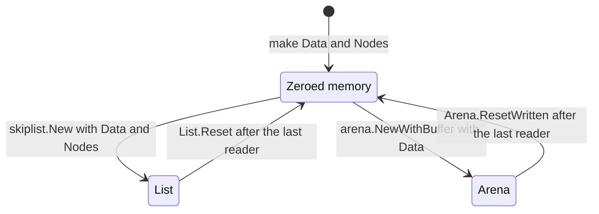

<!--
  ~ Copyright ThesmOS B.V. 2026
  ~ SPDX-License-Identifier: Apache-2.0
-->

# RFC-0076: Lists and Arenas over Caller Memory

## Summary

`skiplist.New` and `arena.NewWithCapacity` allocate the memory of their
arenas, and neither takes memory that the caller already has. An engine that
moves the memory of a memtable between a `List` and an `Arena` allocates and
clears that memory again at each move. We propose three additions:

- `arena.NewWithBuffer` builds an `Arena` over zeroed memory of the caller.
- `arena.NewBumpWithArray` builds a `Bump` over an array of the caller.
- `skiplist.Config` gets `Data` and `Nodes`, the memory of the two arenas of
  a `List`. `skiplist.NodeWords` returns the length of `Nodes`.

With memtables of 64 MiB, a `List` over the memory of the caller takes 39 ns
in place of 3.98 ms. An `Arena` takes 11 ns in place of 1.80 ms.

## Motivation

### Each move allocates the memory again

An engine can keep one place of memory for each memtable. It gives a cleared
place to a memtable of either kind. A log memtable writes into an
`arena.Arena` of the memtable size. The `skiplist.List` of a kv memtable has
two arenas of that size. `arena.NewWithCapacity` allocates the array of an
Arena, and `skiplist.New` allocates the arrays of both arenas of a List. So
the engine drops the memory of a place at each change of kind and makes new
memory.

A probe measured the cost with memtables of 64 MiB. The garbage collector
frees the memory of the call before, so each call takes memory that the
runtime clears again. Each figure is the median of 12 runs in rotating order,
on one thread of an AMD Ryzen 9 9950X3D with Go 1.27.2:

| Call | Time | Allocations | Bytes |
|---|---|---|---|
| `skiplist.New` with two arenas of 64 MiB | 3.98 ms | 5 | 128 MiB |
| `arena.NewWithCapacity(64 << 20)` | 1.80 ms | 2 | 64 MiB |

A mixed workload of issue 77 changed the kind of 254 places of 64 MiB a
second. The allocations and their clears took about three quarters of a core.

The memory that the engine drops is already zero. `List.Reset` zeroes the
bytes and the words that the List reserved. `Arena.ResetWritten` zeroes the
written prefix of an Arena.

### Prior art

Pebble keeps the buffer of an obsolete memtable in `DB.memTableRecycle`, and
builds the arena of the next memtable over it with `arenaskl.NewArena(buf)`.
It does not clear the buffer. Its skip list writes every field of a node
before it links the node, and `Skiplist.Reset` writes the links of the head
and the tail.

## Detailed design

### Components

| Component | Responsibility |
|---|---|
| `arena.NewWithBuffer` | An `Arena` over the array of a zeroed buffer of the caller |
| `arena.NewBumpWithArray` | A `Bump` over an array of the caller, which reserves the values as the caller left them |
| `skiplist.Config.Data`, `Config.Nodes` | The memory of the data arena and of the node arena of a `List` |
| `skiplist.NodeWords` | The number of words of the node arena of a `NodeBytes` |
| `skiplist.New` | Builds the arenas of a `List` over the memory of `Config`, and writes the head node |

### API

```go
// package arena

// NewWithBuffer returns an empty Arena over the array of buf, with the
// capacity of buf. Every byte of buf up to its capacity must be zero.
func NewWithBuffer(buf []byte) *Arena

// NewBumpWithArray returns an empty Bump over the array of values, with
// room for len(values) values.
func NewBumpWithArray[T any](values []T) *Bump[T]
```

```go
// package skiplist

type Config struct {
	// Data is the memory of the data arena, or nil. New uses the first
	// DataBytes bytes of Data.
	Data []byte

	// Nodes is the memory of the node arena, or nil. New uses as many
	// words of Nodes as NodeWords returns for NodeBytes.
	Nodes []uint32

	DataBytes int
	NodeBytes int
	Seed      uint64
}

// NodeWords returns the number of words of the node arena of a List with a
// NodeBytes of nodeBytes: the 28 words of the head node and a word for each
// 4 bytes of nodeBytes.
func NodeWords(nodeBytes int) int
```

`New` returns `ErrSize` for a `Data` shorter than `DataBytes`, and for a
`Nodes` shorter than `NodeWords(NodeBytes)`. A `Config` without `Data` and
`Nodes` builds a List as before.

An engine moves the memory of a place between the two kinds as follows:

```go
data := make([]byte, size)
nodes := make([]uint32, skiplist.NodeWords(size))

cfg := skiplist.Config{Data: data, Nodes: nodes, DataBytes: size, NodeBytes: size, Seed: seed}
l, err := skiplist.New(cfg)
if err != nil {
	return err
}

// After the last reader of the List.
l.Reset()
a := arena.NewWithBuffer(data)

// After the last reader of the Arena.
a.ResetWritten(written)
l, err = skiplist.New(cfg)
```

### The memory of a place



- The caller keeps the memory and passes it to a constructor. A `List` or an
  `Arena` uses the memory until the caller drops it.
- The caller does not write the memory while a `List` or an `Arena` uses it.
  It reuses the memory only after the last reader.
- A place keeps its `Nodes` aside while it is an `Arena`.
- No method returns the memory, because the caller already has its own
  slices.

### The content of the memory

- `Arena.Alloc` returns spare capacity without a clear, and
  `Arena.AppendVia` passes the spare capacity to its appender. So
  `NewWithBuffer` requires zeroed memory. It does not check the memory, as
  `ResetWritten` does not check its own precondition.
- A `List` accepts memory of any content. `New` writes the 28 words of the
  head node. `Add` writes every word of a node before it links the node, and
  the bytes of the key and the value before it writes the node.
- `NewBumpWithArray` reserves the values as the caller left them, apart from
  the values that `Bump.Reset` zeroed.
- Memory that was zero at `skiplist.New` is zero again after `List.Reset`. A
  buffer of `NewWithBuffer` is zero again after `Arena.ResetWritten` of the
  written prefix, unless the Arena moved past the capacity of the buffer.

### Invariants

- A `List` over the memory of `Config` does not allocate an array. An `Arena`
  of `NewWithBuffer` does not allocate an array until a write passes the
  capacity of the buffer.
- A `List` writes every word and every byte of its memory before it reads
  them, so its entries do not depend on the content of the memory at `New`.
- A `Nodes` of `NodeWords(NodeBytes)` words gives a `List` the room for nodes
  of a `List` without `Nodes`.
- Memory that was zero at a constructor is zero after the `Reset` of the
  `List` or after the `ResetWritten` of the `Arena`.

### Bounds

On the memory of the motivation, with the same method:

| Call | Time | Allocations | Bytes |
|---|---|---|---|
| `skiplist.New` over `Data` and `Nodes` | 39.4 ns | 3 | 176 |
| `arena.NewWithBuffer` | 10.7 ns | 1 | 48 |

The 3 allocations of `New` are the `List` and its two `Bump` values. A clear
of 64 MiB takes 951 µs, and a check that 64 MiB are zero takes 966 µs.

| Quantity | Bound |
|---|---|
| Allocations of `skiplist.New` over the memory of `Config` | 3 objects of 176 bytes in all |
| Allocations of `arena.NewWithBuffer` | 1 object of 48 bytes |
| Words that `New` writes into `Nodes` | 28 |
| Words of `Nodes` beyond `NodeBytes`/4 | 28 |

### Failure handling

| Condition | Result |
|---|---|
| A `Data` shorter than `DataBytes` | `New` returns `ErrSize` |
| A `Nodes` shorter than `NodeWords(NodeBytes)` | `New` returns `ErrSize` |
| A `Data` or a `Nodes` of any content | A `List` without entries, because `New` writes the head node |
| A buffer of `NewWithBuffer` with a byte that is not zero | A programmer error. `Alloc` returns the byte in place of a zero, and nothing detects it |
| A write past the capacity of the buffer of `NewWithBuffer` | The `Arena` moves to a new array, and the buffer keeps the bytes written before the move. `Cap` exceeds the capacity of the buffer |
| A reuse of the memory while a reader of the `List` or the `Arena` remains | A programmer error. The reader reads the bytes of the next user |

### Allocation contract

| Call | Objects |
|---|---|
| `arena.NewWithBuffer` | 1: the `Arena` |
| `arena.NewBumpWithArray` | 1: the `Bump` |
| `skiplist.New` with `Data` and `Nodes` | 3: the `List` and its two `Bump` values |
| `skiplist.New` without `Data` and `Nodes` | 5, as before |

### Tests

| # | Guarantee |
|---|---|
| 1 | `NewWithBuffer` returns an empty arena with the capacity of `buf` over drawn capacities |
| 2 | An arena of `NewWithBuffer` appends into `buf`, and a write past the capacity of `buf` moves it to a new array while `buf` keeps its bytes |
| 3 | `NewBumpWithArray` returns a `Bump` over the array with a capacity of `len(values)`, and the `Bump` reserves the values of the array |
| 4 | `New` returns `ErrSize` for a `Data` that is shorter, and for a `Nodes` that is shorter |
| 5 | A `List` keeps its entries in the memory of `Data` and `Nodes` |
| 6 | A `List` over memory of any content yields its entries in order, forward and back |
| 7 | `Reset` zeroes the memory of `Data` and `Nodes` that was zero at `New` |
| 8 | `NodeWords` counts the head node and a word for each 4 bytes, rounds down and counts a negative `nodeBytes` as 0 |
| 9 | `NewWithBuffer` and `NewBumpWithArray` allocate 1 object, and `New` over memory allocates 3, in the `Allocs` tests and the benchmarks |
| 10 | The suites cover every statement, and dokimi-mutate-go detects every mutant |

## Alternatives considered

### A. Nodes of bytes

`Config.Nodes` would be a `[]byte`, so one byte buffer could serve the data
arena, the node arena and an `Arena`. Pebble keeps its nodes and its data in
one byte buffer.

**Why not:** the node arena is an array of `uint32` words that `sync/atomic`
reads and writes. A `[]byte` becomes a `[]uint32` only through `unsafe`,
which core does not import. A place keeps a `[]uint32` aside instead, and
moves only its data memory between a `List` and an `Arena`.

### B. A method that returns the memory

`List.Release() (data []byte, nodes []uint32)` would return the memory of a
List and leave the List unusable.

**Why not:** the caller already keeps the slices that it passed. A List
after `Release` needs a result for every later call, because core does not
panic at run time. Every read of a List also needs its head node, which is
in the memory that `Release` returns.

### C. A clear in the constructors

`skiplist.New` and `arena.NewWithBuffer` would clear the memory of the
caller, so the caller could pass memory of any content.

**Why not:** a clear of 64 MiB takes 951 µs, about half of what the
allocation of an Arena costs today. The memory is zero already after
`List.Reset` and `Arena.ResetWritten`.

### D. A check in the constructors

The constructors would check that every byte is zero, and return an error
otherwise.

**Why not:** the check reads every byte, 966 µs for 64 MiB. `ResetWritten`
documents an unchecked precondition for the same reason.

### E. A List that moves to new memory

A method such as `List.ResetWith(data, nodes)` would reuse a List and its two
`Bump` values, so a change of kind would not allocate.

**Why not:** it saves 3 objects of 176 bytes per change, and at most the
39 ns of `New`. The method also needs a contract for the readers that still
use the List when it moves to the new memory.

### F. A List and an Arena for each place

The engine would keep a `List` and an `Arena` for each place, and use the one
of the current kind.

**Why not:** a place would keep three times the memtable size: two arenas
for the `List` and one for the `Arena`. With the proposal a place keeps twice
the memtable size: its data memory and the `Nodes` of its `List`.

## Drawbacks

- `arena` adds 2 functions. `skiplist` adds 2 fields of `Config` and 1
  function, and `ErrSize` covers one more case. Its text changes from "the
  capacity of an arena is out of range" to "the size of an arena is out of
  range".
- `NewWithBuffer` has a precondition that nothing checks. An `Arena` over
  memory that is not zero returns a byte that is not zero from `Alloc`.
- A place that has been a `List` keeps its `Nodes` aside while it is an
  `Arena`: `NodeBytes` plus 112 bytes.
- The caller decides when the last reader of a `List` or an `Arena` is done.
  A reuse before that corrupts the reads of the reader.

## Open questions

None.

## Unresolved / future work

None.

## References

- Issue 77 of thesm-os/core, the request and the measurements of a mixed
  workload.
- Pebble, `internal/arenaskl/arena.go`, `internal/arenaskl/skl.go` and
  `db.go` at a7b8321, an arena over a buffer of the caller and the recycling
  of the buffer of a memtable:
  <https://github.com/cockroachdb/pebble/tree/a7b8321871e3e3c19be21eaf42a6aaa7e2d04f23>.
- RFC-0011, the arena.
- RFC-0062, sorted tables and memtables.
- ADR-0057, a Bump reserves values without locks.
- `arena/lifecycle.go`, `Arena.ResetWritten`, and `skiplist/list.go`, `New`
  and `insert`.
