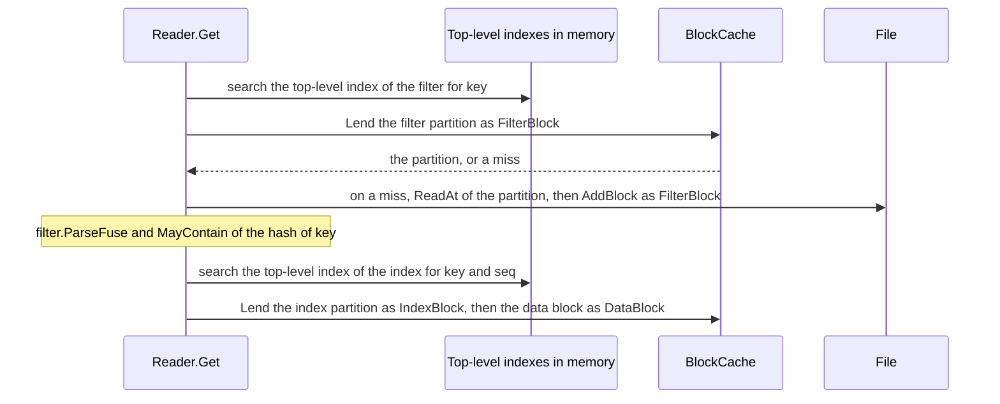

<!--
  ~ Copyright ThesmOS B.V. 2026
  ~ SPDX-License-Identifier: Apache-2.0
-->

# RFC-0077: Partitioned Index and Filters of a Table

## Summary

A `sstable.Reader` keeps the whole index block and the whole filter block of
its table in memory, 1 to 2% of the bytes of the table. We propose a second
version of the table format, in which the Writer cuts the index and the
filter into partitions of about `WriterOptions.PartitionSize` bytes. A Reader
of such a table keeps a top-level index of each kind of partition in memory.
It reads the partitions through its `BlockCache`, as it reads data blocks.

- `WriterOptions.PartitionSize` sets the size of a partition. With 0 the
  Writer writes the format of version 1.
- A Reader reads both versions.
- `Reader.MayContain` and `Reader.Span` read partitions, so each takes a
  context and returns an error.
- `filter.FuseSize` returns the length of the encoding of a filter, and
  `filter.MaxFuseSize` the length of the largest encoding of at most a count
  of keys. The Writer needs both to cut a filter partition.
- `WriterOptions.MaxSize` returns the most bytes of a table from the number
  of its entries and the bytes of their keys and values.

## Motivation

### The memory of an open table

`Open` reads the index block and the filter block of a table, and the Reader
keeps both until the caller drops it. A probe wrote tables of 20-byte keys in
data blocks of 4 KiB, with fingerprints of 8 bits and without a filter. It
read `Reader.Footprint` after `Open`:

| Values | Table | Data blocks | `Footprint` without a filter | `Footprint` with a filter | Share of the table |
|---|---|---|---|---|---|
| 100 B | 65,189,707 B | 15,115 | 679,725 B | 1,318,719 B | 2.02% |
| 1,000 B | 67,741,119 B | 13,159 | 591,790 B | 671,680 B | 0.99% |

The index takes 45 bytes for each data block. The filter of the table of
100-byte values takes 9.14 bits for each key, which is half of the footprint
of the table. Tables of 16 MB take the same shares.

A process that keeps its tables open keeps 1 to 2% of their bytes in memory,
whether it reads them or not. An engine that keeps 30 times its memory in
tables spends 30 to 60% of its memory on open Readers. No `BlockCache` bounds
that memory, because a Reader keeps the two blocks outside the cache.

Each workaround trades the memory for another cost:

- A cache of open Readers closes a Reader and opens it again on demand. Each
  `Open` of a table of 100-byte values then reads 1.32 MB of index and filter
  for a lookup of one data block of about 4 KiB.
- Larger data blocks shrink the index and leave the filter as it is. Each
  point read then reads more bytes.
- Narrower fingerprints shrink the filter. At 4 bits the filter admits 6.25%
  of the keys that the table does not contain.

### The size of a table before the write

A store that takes the bytes of a flush from an account of the free bytes of
its disk needs a bound of the size of the table before the Writer writes it.
The size does not follow from the bytes of the entries alone. The index has
the internal key of the last entry of each data block, the top-level index of
the index has it again for each index partition, and the top-level index of
the filter has the last key of each filter partition.

A probe wrote tables of random keys and values in data blocks and partitions
of 4 KiB, with a restart point every 16 entries, Snappy and fingerprints of 8
bits. It compared each table with the bytes that its entries take in a
`skiplist.List`:

| Key bytes | Value bytes | Entries | Table bytes | Skiplist bytes | Ratio |
|---|---|---|---|---|---|
| 16 | 100 | 10,000 | 1,238,266 | 1,543,452 | 0.80 |
| 1,024 | 0 | 2,000 | 2,729,068 | 2,124,584 | 1.28 |
| 4,096 | 0 | 1,000 | 12,381,138 | 4,134,456 | 2.99 |
| 65,535 | 0 | 100 | 19,735,541 | 6,557,348 | 3.01 |
| 100 | 8,192 | 1,000 | 8,447,603 | 8,330,332 | 1.01 |

A key of 4,096 bytes or more fills a data block and an index partition
alone, so the table contains each key three times.

### Prior art

RocksDB cuts the index and the filter of a table into partitions of
`metadata_block_size` bytes, 4 KiB by default. It keeps a top-level index of
each kind of partition, and reads the partitions through its block cache.
Its documentation puts the top-level index at 0.1 to 1% of the size of the
index and the filter. Two of its measurements:

- A database of 86 GB on HDD behind a block cache of 60 MB served 5
  operations a second without partitions and 55 with them.
- The throughput of a database of 300 GB on SSD fell from 38,000 to 23,000
  transactions a second when its block cache shrank from 6 GB to 2 GB. With
  partitions it fell to 30,000.

RocksDB cuts its filter partitions apart from its index partitions by
default (`decouple_partitioned_filters`). The option "enables these metadata
blocks to hit their target size much more accurately".

## Detailed design

### Components

| Component | Responsibility |
|---|---|
| `WriterOptions.PartitionSize` | The size of a partition, or 0 for format version 1 |
| `Writer` | Cuts index partitions and filter partitions, and writes them and their two top-level indexes after the data blocks |
| `filter.FuseSize` | The length of the encoding of a filter of n hashes |
| `filter.MaxFuseSize` | The length of the largest encoding of at most n hashes, so the Writer cuts a filter partition at the most keys up to which every count fits `PartitionSize` |
| `WriterOptions.MaxSize` | The most bytes of a table of the counts of its entries |
| `Reader` | Keeps the two top-level indexes in memory, and reads the partitions through its cache with the role of each partition |
| `Iter` | Keeps a reference to the index partition of its data block, beside the data block |
| `Reader.MayContain`, `Reader.Span` | Read the partitions of their keys under a context |

### The format of version 2

A table of version 2 has, in this order: its data blocks, its filter
partitions, its index partitions, the top-level index of the filter, the
top-level index of the index and the footer. Every block has the trailer of
version 1.

- An index partition has the layout of the index block of version 1, with
  the entries of consecutive data blocks. The Writer ends a partition with
  the entry that brings its entries to `PartitionSize` bytes or more.
- A filter partition is the encoding of a `filter.Fuse` over the hashes of
  the distinct keys of a range of the table. The Writer ends a partition at
  the most keys n for which the encoding of every count of keys up to n takes
  at most `PartitionSize` bytes. The length of an encoding can fall where its
  count reaches a power of two: at 8 bits, 242 keys take 466 bytes and 256
  keys take at most 408. A partition has at least one key, and every
  partition of more than one key has at most `PartitionSize` bytes. The last
  partition of a table can have fewer keys, and it fits too. The cuts of the
  filter do not align with the cuts of the index.
- The top-level index of the index has the layout of the index block. Its
  entry for a partition has the internal key of the last entry of the
  partition. The value of the entry has the offset, the length and the number
  of data blocks of the table up to the end of the partition as varints,
  then the CRC32C of the partition as a uint32.
- The top-level index of the filter has the layout of the index block. Its
  entry for a partition has the last key of the partition with the sequence
  0. The value has the offset and the length as varints, then the CRC32C as a
  uint32. The sequence 0 makes the entry the last internal key of its key, so
  a search for a key at the highest sequence finds the partition of the key.
- The footer has the layout of version 1 and the version 2. Its index fields
  state the top-level index of the index. Its filter fields state the
  top-level index of the filter, or three zeros for a table without a
  filter.

| Part | Version 1 | Version 2 |
|---|---|---|
| Between the data blocks and the footer | The filter block and the index block | The partitions and the two top-level indexes |
| The index fields of the footer | The index block | The top-level index of the index |
| The filter fields of the footer | The filter block | The top-level index of the filter |
| The memory of a Reader | The index block, the filter block and the summary | The two top-level indexes and the summary |

The data blocks of a table of version 2 are the data blocks of version 1 for
the same entries and options. They remain contiguous, so `Span`, the read
ahead of a cursor and the check of the place of a data block work as in
version 1. The data blocks end at the first partition.

### API

```go
// package sstable

type WriterOptions struct {
	// ...the fields of version 1

	// PartitionSize is the size in bytes of an index partition and of a
	// filter partition. With 0 the Writer writes the index and the filter as
	// one block each, in format version 1. The largest PartitionSize is
	// 2^32 - 1.
	PartitionSize int
}

// MayContain reports whether the table may contain an entry with key. For a
// table of version 2 it reads the filter partition of key under ctx.
func (r *Reader) MayContain(ctx context.Context, key []byte) (bool, error)

// Span returns the data blocks of the table that can contain an entry whose
// key is at or after lower and before upper. For a table of version 2 it
// reads the index partitions of lower and upper under ctx.
func (r *Reader) Span(ctx context.Context, lower, upper []byte) (Span, error)

// MaxSize returns the most bytes of a table that a Writer under o writes for
// at most entries entries, whose keys take at most keyBytes bytes in all and
// at most longest bytes each, and whose values take at most valueBytes bytes
// in all.
func (o WriterOptions) MaxSize(entries, keyBytes, valueBytes int64, longest int) (int64, error)
```

```go
// package filter

// FuseSize returns the length of the encoding that FuseBuilder.Append
// builds for n hashes with fingerprints of bits bits.
func FuseSize(n, bits int) (int, error)

// MaxFuseSize returns the length of the largest encoding that
// FuseBuilder.Append builds for at most n hashes with fingerprints of bits
// bits. It never falls as n grows.
func MaxFuseSize(n, bits int) (int, error)
```

`NewWriter` returns `ErrOptions` for a negative `PartitionSize` and for one
above 2^32 - 1. `FuseSize` returns the errors of `FuseBuilder.Append` for its
arguments. Every attempt of a build has the same number of fingerprints, so
the length depends on n and bits alone. `MaxFuseSize` returns the errors of
`FuseSize`.

`MaxSize` returns `ErrOptions` for options that `NewWriter` refuses, and the
error of `MaxFuseSize` for a filter block of more than 2^32 fingerprints. It
counts a negative count as 0, and returns `math.MaxInt64` for a count above
2^48.

### The reads



- `Open` reads the footer and the two top-level indexes, checks their
  CRC32C checksums and keeps both with the summary. It reads the first index
  partition and the first data block for the smallest key, and takes the
  largest key from the last entry of the top-level index of the index.
- `Get` searches the top-level index of the filter, reads the filter
  partition of the key and asks it. A key that the partition refuses costs
  no further read. `Get` then searches the top-level index of the index,
  reads the index partition and the data block.
- A cursor keeps a reference to its index partition beside its data block.
  `Next` and `Prev` read the next or the previous partition only at the end
  of the current one.
- `MayContain` reads the filter partition of its key. `Span` reads the index
  partitions of lower and upper, and counts the data blocks between them
  from the top-level entries.
- A partition is a block of the table at its offset, so a cache keeps it
  under the identity of the table and its offset, as it keeps a data block.
  A Reader lends it from a `LendingCache`, and fills the cache on a miss. A
  cursor with `NoFill` does not add a partition.
- A Reader passes `IndexBlock` for an index partition and `FilterBlock` for
  a filter partition to `Lend` and `AddBlock` of a `LendingCache`. A cache
  then counts the lookups of the partitions apart from the lookups of the
  data blocks. RFC-0075 designs the roles.
- A Reader without a cache reads each partition from the File for each read
  that needs it.

### The bound of a table

`MaxSize` adds up the parts of a table at their largest:

- Each entry at a restart point with no shared prefix: three varints, the
  internal key and the value. A varint of a length takes one byte, and at
  most one more for each 128 bytes of the length.
- The most data blocks that the bytes of the entries allow: one for each
  `BlockSize` bytes of entries and one more, and at most one for each entry.
  Each block adds a uint32 for each restart point, one for their count and a
  trailer.
- An entry of the index for each data block, and the most index partitions
  that the bytes of the index allow.
- The keys of one kind of index: at most `longest` bytes each and at most
  `keyBytes` in all. The same key can be in the index, the top-level index
  of the index and the top-level index of the filter, so each kind has a cap
  of its own.
- Each filter or filter partition at the largest encoding of at most its
  keys, from `filter.MaxFuseSize`.
- Each offset and each length of a place at the bytes of the varint of the
  largest value that it can take. A bound of the size of the table bounds
  the offset of a partition, so `MaxSize` sums again with the varint of the
  bound before it until the varint does not change.

The bound counts every block without compression. It counts a data block
for each `BlockSize` bytes of entries, so a table of entries just under
`BlockSize` takes less than its bound. A probe of 140 entries with keys of
131 bytes and no values, in blocks of 144 bytes, wrote 31,863 bytes against a
bound of 43,931.

### Invariants

- A table of version 2 and a table of version 1 of the same entries return
  the same entries, and the same results of `Get` and `Span`.
- The top-level entry of every partition has the CRC32C of the partition, and
  the footer has the CRC32C of each top-level index. A change of any bit of a
  table of version 2 fails a checksum, as in version 1.
- An index partition ends with the first entry that brings its entries to
  `PartitionSize` bytes or more. A filter partition of more than one key has
  at most `PartitionSize` bytes.
- A cursor keeps at most two references: its index partition and its data
  block.
- `MaxSize` of the counts of a table is at least the size of the table.

### Failure handling

| Condition | Result |
|---|---|
| A top-level index that does not fit the table, or whose CRC32C differs from the footer | `Open` returns `ErrCorrupt` |
| A top-level entry that does not decode, or a partition outside the bytes between the data blocks and the top-level indexes | The read returns `ErrCorrupt` |
| A partition whose CRC32C differs from its top-level entry | The read returns `ErrCorrupt` |
| A filter partition that `filter.ParseFuse` refuses | `Get` and `MayContain` return `ErrCorrupt` |
| A context that ended before a read of a partition | The read returns the error of the context |
| An error of the File | The read returns an error that wraps it |

### Tests

| # | Guarantee |
|---|---|
| 1 | `FuseSize` returns the length of the encoding that `Append` builds, over drawn counts and every width |
| 2 | A Writer with a `PartitionSize` cuts index partitions and filter partitions at their sizes, over drawn entries and sizes |
| 3 | A table of version 2 returns the entries, the `Get` results and the spans of a table of version 1 of the same entries |
| 4 | The machines of the cursor and of concurrent reads pass over tables of both versions, through every kind of cache |
| 5 | Every truncation and every flipped bit of a golden table of version 2 returns `ErrCorrupt` |
| 6 | Each malformed top-level entry and each partition that does not check returns `ErrCorrupt` |
| 7 | A `Get` of a block that a `LendingCache` contains with its partitions does not allocate |
| 8 | The golden tables of version 2 keep their bytes |
| 9 | `MaxFuseSize` returns the largest `FuseSize` of the counts up to n, for every count up to 2^12 and the counts at each power of two up to 2^21 |
| 10 | Every filter partition of more than one key fits `PartitionSize`, also a last partition of 242 keys at 408 bytes and 8 bits |
| 11 | `MaxSize` is at least the size of each table of drawn entries and options, with long keys and long values |
| 12 | `MaxSize` returns the size of each table of three entries whose counts fix its layout, in both format versions, with and without a filter |
| 13 | `MaxSize` exceeds a table of small random entries in blocks of 2 KiB or more by at most a quarter of it, a partition and 4 KiB |
| 14 | The suites pass under the race detector, cover every statement, and dokimi-mutate-go detects every mutant |

## Alternatives considered

### A. A cache of open Readers

The engine would close Readers that it does not read, and open them again on
demand.

**Why not:** each `Open` of a table of 100-byte values reads 1.32 MB of index
and filter for a lookup of one data block of about 4 KiB. The cache of
Readers also needs its own bound beside the block cache.

### B. Filter partitions with the cuts of the index

The Writer would end a filter partition with each index partition, as
RocksDB did before `decouple_partitioned_filters`.

**Why not:** a filter partition then has the keys of about 91 data blocks.
At values of 1,000 bytes that is about 455 keys, whose encoding takes 14.13
bits a key. A partition of about 4 KiB has about 2,900 keys at 11.21 bits a
key.

### C. Partitions between the data blocks

The Writer would write each partition after the data block that ends it, and
keep no partition until `Close`.

**Why not:** the data blocks would no longer be contiguous. `Span` would
count the bytes of partitions, and a read ahead would read them. The Writer
keeps about 1.4 bytes for each key and 45 bytes for each data block until
`Close` instead.

### D. Index partitions alone

The Writer would partition the index and keep one filter block.

**Why not:** the filter of the table of 100-byte values takes half of its
footprint, so the Reader would keep 1% of the table in memory.

### E. Top-level indexes in the cache

A Reader would read the top-level indexes through the cache, as RocksDB does
under `cache_index_and_filter_blocks`.

**Why not:** every read would take one more lookup in the cache. The two
top-level indexes of a table of 64 MB take about 16 KB, 1.3% of the memory
of version 1.

### F. `MayContain` and `Span` without a context

The two methods would keep their signatures, and read partitions under
`context.Background`.

**Why not:** every other read of a table takes the context of its caller,
and a File and a cache that wait end their waits with that context. A read
under another context could not be cancelled.

### G. A dry run of the Writer

A store would write each table to a Sink that counts its bytes before the
write that keeps the table.

**Why not:** the dry run costs a second write of every table, for a number
that the counts of the entries bound.

### H. A bound from the bytes of the entries

A store would reserve the bytes of the entries of a table and a fixed share
more.

**Why not:** the table of keys of 4,096 bytes of the motivation takes 2.99
times the bytes of its entries in a skiplist. No share fits keys of every
length.

### I. A cut of a filter partition at the encoding of its own count

The Writer would end a filter partition at the most keys whose encoding fits
`PartitionSize`, whatever the encodings of the counts below.

**Why not:** a count below a power of two can take more bytes than a larger
count. The last partition of a table can then pass `PartitionSize`: at 8
bits, 242 keys take 466 bytes where 256 keys take at most 408.

## Drawbacks

- `MayContain` and `Span` change their signatures, for tables of version 1
  too.
- A `Get` that misses the cache reads up to three blocks: a filter
  partition, an index partition and a data block.
- A `Get` through a warm cache takes three lookups of the cache instead of
  one.
- A Reader of version 2 without a cache reads up to two partitions from the
  File for each read.
- The Writer keeps the finished partitions until `Close`: about 1.4 bytes a
  key for the filter at 8 bits and 45 bytes a data block for the index.
- `sstable` reads two format versions, and its tests cover both.
- `MaxSize` counts no compression and no shared prefix, and a data block for
  each `BlockSize` bytes of entries. A table of entries with long shared
  prefixes or of entries just under `BlockSize` takes less than its bound.
- `NewWriter` calls `MaxFuseSize` at each step of the search for the keys of
  a filter partition, and `MaxFuseSize` calls `FuseSize` once for each power
  of two up to its count.

## Open questions

None.

## Unresolved / future work

None.

## References

- Issue 78 of thesm-os/core, the request and its probe.
- Issue 82 of thesm-os/core, the request for the bound of the size of a
  table and its probe.
- RFC-0062, sorted tables and memtables: alternative H and the bound of the
  memory of a Reader.
- RFC-0071, the bounded workspace of a table writer.
- RFC-0072, the read ahead of a table cursor.
- RFC-0075, blocks that a cache lends to readers.
- RocksDB, Partitioned Index/Filters:
  <https://github.com/facebook/rocksdb/wiki/Partitioned-Index-Filters>.
- RocksDB, `metadata_block_size`, `partition_filters` and
  `decouple_partitioned_filters` at 54732b0:
  <https://github.com/facebook/rocksdb/blob/54732b0c8f6f8af34f973d7fae0a234022fcf1fa/include/rocksdb/table.h#L418-L539>.
