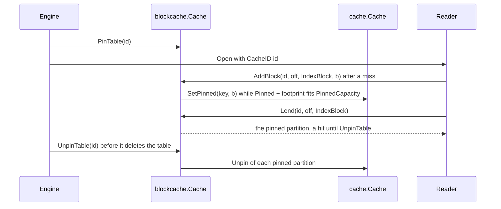

<!--
  ~ Copyright ThesmOS B.V. 2026
  ~ SPDX-License-Identifier: Apache-2.0
-->

# RFC-0079: Pinned Partitions in a Block Cache

## Summary

We propose that a `blockcache.Cache` pins the index and filter partitions of
the tables that its owner names. `PinTable(id)` makes the cache store each
partition of the table id with a pin of `cache.Cache.SetPinned`, so the
evictor does not remove it until `UnpinTable(id)`. `Config.PinnedCapacity`
bounds the bytes of the pinned partitions as a part of `Capacity`. A
partition beyond it enters the cache without a pin.

## Motivation

### A rarely read table reads its partitions again

A `blockcache.Cache` keeps a block by the identity of its table and its
offset, and evicts with S3-FIFO. Partitions of a table that readers rarely use
leave the cache as other tables fill it with data blocks. A `Get` of such a
table then reads its filter partition and its index partition again before
its data block.

The probe of issue 86 ran on core at 506c09b with Go 1.27.2. It wrote 64
tables of 40,000 keys of 100-byte values, in blocks and partitions of 4 KiB,
behind one cache of 16 MiB. The partitions and the top-level indexes of all
64 tables take 6,025,408 bytes, 36% of the cache. After one `Get` of each
table, 100 rounds each ran 10,000 `Get`s of random keys of the first 63
tables and then one `Get` of the last table:

| `Get`s | Reads of the File for each `Get` |
|---|---|
| Of the 63 hot tables | 0.97 |
| Of the last table | 3.00 |

The cache evicts the partitions of the last table between two of its `Get`s.
On a disk that serves 170 random reads a second, the two reads of the
partitions add about 12 ms to each such `Get`.

### Each workaround has a cost

- A `LendingCache` of the consumer can route the partitions to a second
  cache by their role. That splits the memory into two fixed parts, and the
  second cache still evicts the partitions of a rarely read table when the
  partitions of the other tables fill it.
- A larger cache keeps more partitions, and the data blocks of the hot tables
  take the added bytes too.

### Prior art

RocksDB pins the metadata blocks of a table in its block cache.
`MetadataCacheOptions` sets `top_level_index_pinning`, `partition_pinning`
and `unpartitioned_pinning` to a `PinningTier` of `kNone`,
`kFlushedAndSimilar` or `kAll`. Its comment on the older
`pin_l0_filter_and_index_blocks_in_cache` states the mechanism: "filter and
index blocks are stored in the cache, but a reference is held in the 'table
reader' object so the blocks are pinned and only evicted from cache when the
table reader is freed". The pinned blocks count against the capacity of the
cache.

Core's `cache.Cache` has the same mechanism. `SetPinned` stores an entry with
a pin, the evictor skips an entry with a pin, and the last `Unpin` evicts
down to the capacity again.

## Detailed design

### Components

| Component | Responsibility |
|---|---|
| `blockcache.Config.PinnedCapacity` | The bytes of the pinned partitions, as a part of `Capacity` |
| `blockcache.Cache.PinTable` | Names a table whose partitions the cache pins from then on |
| `blockcache.Cache.UnpinTable` | Removes the pins of the partitions of a table |
| `blockcache.Cache.Pinned` | Returns the bytes of the pinned partitions |
| `blockcache.Cache.AddBlock` | Stores a partition of a named table with a pin while it fits `PinnedCapacity` |
| `cache.Cache.SetPinned` | Stores an entry with a pin, as today |

`cache` and `sstable` do not change.

### API

```go
package blockcache

type Config struct {
	// Capacity bounds the sum of the footprints of the blocks of the cache,
	// in bytes. It must be positive.
	Capacity int64

	// PinnedCapacity bounds the sum of the footprints of the partitions that
	// the cache pins for the tables of PinTable, in bytes. The pinned
	// partitions count against Capacity, so PinnedCapacity must be from 0 to
	// Capacity. 0 pins no partition.
	PinnedCapacity int64
}

// PinTable makes the cache pin each index partition and filter partition of
// the table id that AddBlock adds from now on, while the footprints of the
// pinned partitions fit PinnedCapacity. The evictor does not remove a
// pinned partition until UnpinTable(id). A partition beyond PinnedCapacity
// enters the cache without a pin. A partition that the cache contains before
// PinTable does not get a pin, so a consumer calls PinTable before it opens
// the Reader of the table. A second PinTable of a table does not change the
// cache.
func (c *Cache) PinTable(id uint64)

// UnpinTable removes the pins of the partitions of the table id. The
// partitions remain in the cache, and the evictor removes them as other
// blocks. A consumer calls UnpinTable before it deletes the table. The
// pinned partitions of a table that it deletes without UnpinTable keep
// their bytes until the cache is dropped.
func (c *Cache) UnpinTable(id uint64)

// Pinned returns the sum of the footprints of the pinned partitions. It is
// at most PinnedCapacity.
func (c *Cache) Pinned() int64
```

`New` returns `cache.ErrConfig` for a `PinnedCapacity` below 0 or above
`Capacity`.

### Pins

The cache keeps a map from the identity of each table of `PinTable` to the
pinned partitions of the table, by their offset. Each value is the `Pinned`
that `SetPinned` returned. A mutex guards the map and the writes of the sum
of the footprints. `Pinned` reads the sum from an atomic without the mutex.

- `AddBlock` of a `DataBlock` stores the block with `Set`, as today, and
  takes no lock of its own.
- `AddBlock` of an `IndexBlock` or a `FilterBlock` locks the mutex. For a
  table of `PinTable`, it stores the partition with `SetPinned` when the sum
  plus the footprint of the partition fits `PinnedCapacity`, and keeps the
  `Pinned`. It stores the partition with `Set` otherwise, and so it does for
  a table that `PinTable` did not name.
- When the Readers of one table miss a partition at once, each calls
  `AddBlock`. A later call finds the offset among the pins of the table and
  does not store its block. Its Reader keeps the block.
- `UnpinTable` locks the mutex, subtracts the footprint of each partition of
  the table, calls `Unpin` on it, and removes the table from the map. The
  mutex comes before the lock of `cache.Cache` on every path, so the two
  locks cannot deadlock.
- `Lend` takes no lock, as today. A pinned partition has the pin of
  `SetPinned` and the short pin of the `Lend` while it takes its reference.



### Invariants

- `Pinned` is at most `PinnedCapacity`.
- A partition that the cache pinned remains in the cache until `UnpinTable`
  of its table, so every `Lend` of it hits.
- A data block has no pin apart from the pin of a `Lend` in progress.
- `Cost` is at most `Capacity`, apart from the pins of the `Lend` calls in
  progress. The pinned partitions take at most `PinnedCapacity`, so the
  evictor can remove other blocks down to `Capacity`.

### Bounds

| Quantity | Bound |
|---|---|
| The bytes of the pinned partitions | `PinnedCapacity` |
| The bytes of the data blocks and of the unpinned partitions | `Capacity` less the pinned bytes |
| The memory of the pins outside `Capacity` | One map of each table of `PinTable`, and an entry of an offset and a `Pinned` of 16 bytes for each pinned partition |
| A `Lend` | No lock, as today |
| An `AddBlock` of a partition | One lock of the mutex of the Cache beside the lock of `cache.Cache` |
| `UnpinTable` of a table of p pinned partitions | p calls of `Unpin` |

### Allocation contract

| Call | Objects |
|---|---|
| `Lend`, `Pinned`, `UnpinTable` | 0 |
| `PinTable` of a new table | The map of the table, and the growth of the map of the tables |
| `AddBlock` | The entry of `cache.Cache`, and the growth of the map of the table for a pinned partition |

### Failure handling

| Condition | Result |
|---|---|
| A `PinnedCapacity` below 0 or above `Capacity` | `New` returns `cache.ErrConfig` |
| A partition whose footprint does not fit the rest of `PinnedCapacity` | `AddBlock` stores it without a pin |
| A partition that a Reader adds again while the cache pins it | `AddBlock` does not store the second block |
| `UnpinTable` of a table that `PinTable` did not name | No change |
| A table deleted without `UnpinTable` | Its pinned partitions keep their bytes until the cache is dropped |

### Tests

| # | Guarantee |
|---|---|
| 1 | A stateful machine of `PinTable`, `UnpinTable`, `AddBlock` and `Lend` of drawn tables, offsets, roles and footprints passes against a model of the pins: `Pinned` equals the sum of the model, every pinned partition of the model is a hit, and `Cost` is at most `Capacity` |
| 2 | Of 16 pinned tables of 4,000 keys behind a cache of 1 MiB with a `PinnedCapacity` of 512 KiB, a `Get` of the last table after each round of 500 `Get`s of the other tables reads its data block alone |
| 3 | A partition beyond `PinnedCapacity` enters without a pin, and data blocks evict it |
| 4 | After `UnpinTable`, data blocks evict the partitions of the table, and a partition that `AddBlock` adds later has no pin |
| 5 | Two `AddBlock` calls of one pinned partition keep one pin and one block |
| 6 | `New` returns `cache.ErrConfig` for a `PinnedCapacity` below 0 and above `Capacity` |
| 7 | `TestCacheAllocs` and the benchmarks state the counts of the allocation contract |
| 8 | The suites pass under the race detector, cover every statement, and dokimi-mutate-go detects every mutant |

## Alternatives considered

### A. A second cache of the consumer for the partitions

A `LendingCache` of the consumer would route each partition to a second
cache by its role.

**Why not:** the two caches split the memory into two fixed parts. The
second cache contains the partitions of every table, so the partitions of
the hot tables still evict the partitions of a rarely read one.

### B. A tier of pinned partitions inside the Cache

The Cache would keep a second `cache.Cache` of `PinnedCapacity` bytes for
the partitions of the tables of `PinTable`, and the pinned partitions would
evict each other by S3-FIFO. `Lend` would read an immutable set of the
pinned tables through an atomic pointer to choose the tier.

**Why not:** a `cache.Cache` has a fixed capacity, so the tier takes
`PinnedCapacity` bytes from the data blocks also while the pinned
partitions use less. The pins inside one `cache.Cache` give the unused
bytes to the data blocks. A `PinnedCapacity` that is smaller than the
partitions of the tables that an engine pins reverses this, because the
tier would keep the partitions that readers use most.

### C. A priority for the partitions in S3-FIFO

The cache would admit partitions to the main queue of S3-FIFO, or count
more hits for them.

**Why not:** a priority delays the eviction of a partition and does not
bound it. Enough misses of data blocks still evict the partitions of a
table that readers use once in 10,000 `Get`s.

### D. Partitions in the memory of a pinned Reader

An option of `ReaderOptions` would make a Reader keep every partition that
it reads, as it keeps the top-level indexes.

**Why not:** the memory of the partitions would be outside the capacity of
the cache, so an engine would budget a second pool. The partitions would
also take a second path of reads beside the cache.

### E. Tiers of tables in core

The Cache would pin the partitions of the tables of a tier, as RocksDB's
`PinningTier` does for the tables of a flush or for all tables.

**Why not:** core does not know the levels of an engine, and the choice of
the tables is the policy of the engine. `PinTable` leaves that choice to
the engine. An engine pins the tables of its flushes, or every table.

### F. A pin of the partitions that the cache contains at PinTable

`PinTable` would also pin the partitions of the table that the cache
contains already.

**Why not:** the Cache keeps a block by its table and its offset, and has
no list of the blocks of a table. `Lend` would need a lock to record a pin
of a partition that it finds. A consumer calls `PinTable` before it opens
the Reader, and `Open` does not add a block to the cache.

## Drawbacks

- A consumer that deletes a table without `UnpinTable` keeps the pinned
  partitions of the table in memory until it drops the cache.
- `PinTable` after the first reads of a table pins only the partitions that
  the cache adds later.
- The evictor examines a pinned partition when the partition comes to the
  tail of the main queue of S3-FIFO, and moves it to the head. A pass over
  the main queue costs one step for each pinned partition.
- The map of the pins takes memory outside `Capacity`, an entry for each
  pinned partition.
- `AddBlock` of a partition locks the mutex of the Cache beside the lock of
  `cache.Cache`.

## Open questions

None.

## Unresolved / future work

None.

## References

- Issue 86, <https://github.com/thesm-os/core/issues/86>.
- RFC-0049, the bounded cache.
- RFC-0075, blocks that a cache lends to readers.
- RFC-0077, partitioned index and filters of a table.
- ADR-0053, `SetPinned` stores an entry with a pin.
- ADR-0059, the last unpin evicts down to the capacity.
- ADR-0018, core ships mechanisms, not lifecycles.
- facebook/rocksdb at 54732b0c8f, `include/rocksdb/table.h`,
  `PinningTier` and `MetadataCacheOptions`,
  <https://github.com/facebook/rocksdb/blob/54732b0c8f6f8af34f973d7fae0a234022fcf1fa/include/rocksdb/table.h#L125-L171>,
  and `pin_l0_filter_and_index_blocks_in_cache`,
  <https://github.com/facebook/rocksdb/blob/54732b0c8f6f8af34f973d7fae0a234022fcf1fa/include/rocksdb/table.h#L245-L267>.
