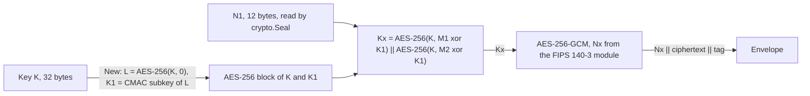

<!--
  ~ Copyright ThesmOS B.V. 2026
  ~ SPDX-License-Identifier: Apache-2.0
-->

# RFC-0086: XAES-256-GCM

## Summary

We propose a package `crypto/xaesgcm` with an AEAD of XAES-256-GCM, as the
C2SP specification defines it, and the algorithm name
`crypto.AlgXAES256GCM`. The AEAD derives an AES-256-GCM key for each message
from its key and the first half of a 192-bit nonce. One key then seals about
2^80 messages with random nonces at a collision risk of 2^-32, where AES-GCM
with random 96-bit nonces seals about 2^32. `crypto.Seal` reads the first half
of the nonce from its random source. The FIPS 140-3 module of the standard
library generates the second half. That keeps the AEAD valid in FIPS 140-only
mode.

## Motivation

Both AEADs of core use a 96-bit nonce. `crypto.Seal` reads each nonce from a
random source. The birthday bound of random 96-bit nonces is about 2^32
messages per key for a collision probability of 2^-32. NIST SP 800-38D sets
the same bound for random IVs.

- A key that seals 553 values a second seals 2^32 messages in 90 days.
- A caller that keeps such a key counts its seals in a store that every
  process shares. Each process reserves a block of seals before it seals.
  The counter costs a write per block, a state that every replica shares,
  and a failure when its store is unreachable.
- The docblock of `crypto.Seal` calls random 96-bit nonces safe for any
  message volume that one key will realistically see. A key of a long-lived
  service exceeds that volume, and nothing signals it.

`crypto` reserves `AlgXChaCha20Poly1305`, whose 192-bit nonce removes the
bound. No implementation in core reports it, because the standard library has
no ChaCha20 construction.

XAES-256-GCM removes the same bound with AES alone:

- It derives a 256-bit key from the key and the first 96 bits of the nonce
  with the counter-mode KDF of NIST SP 800-108r1 over CMAC-AES-256 of NIST SP
  800-38B. It then seals with AES-256-GCM under that key and the last 96 bits
  of the nonce.
- The derivation costs two AES-256 block encryptions per message, and one
  more per key.
- Go 1.27.3 implements the derivation as `CounterKDF` of
  `crypto/internal/fips140/aes/gcm`, an internal package of its FIPS 140-3
  module. No public package of the standard library calls it. The public API
  of `crypto/aes` and `crypto/cipher` expresses the whole construction.

The intermediate KEK of `crypto/kek` bounds its wraps another way. It derives
a wrapping key from the KEK and a random salt, and derives a new one after
every 2^30 wraps. That costs a count of wraps per keeper and a salt in each
wrapped key. XAES-256-GCM does not keep a count.

## Detailed design

### API

```go
package crypto

const (
	// AlgXAES256GCM is XAES-256-GCM of C2SP: AES-256-GCM with a 128-bit tag
	// under a key that the counter-mode KDF of NIST SP 800-108r1 derives
	// from the key and the first 96 bits of a 192-bit nonce.
	AlgXAES256GCM Algorithm = "xaes-256-gcm"
)
```

```go
package xaesgcm

// KeySize is the length of an XAES-256-GCM key.
const KeySize = 32

// NonceSize is the length of the nonce that crypto.Seal reads for the AEAD:
// the first 96 bits of the 192-bit nonce of XAES-256-GCM.
const NonceSize = 12

// New returns an XAES-256-GCM crypto.AEAD over key. key must be KeySize
// bytes long. Any other length returns crypto.ErrKeySize.
func New(key []byte) (crypto.AEAD, error)
```

### Construction



New computes steps 1 and 2 of the specification once per key:

1. L = AES-256 of the key over a block of 16 zero bytes.
2. K1 = L << 1, and K1 = (L << 1) xor 0x87 in its last byte when the first bit
   of L is 1.

Seal and Open compute steps 3 to 6 for each message:

3. M1 = 0x00 || 0x01 || 0x58 || 0x00 || N1.
4. M2 = 0x00 || 0x02 || 0x58 || 0x00 || N1.
5. Kx = AES-256 of the key over M1 xor K1, then over M2 xor K1.
6. Seal and Open apply AES-256-GCM under Kx. `cipher.NewGCMWithRandomNonce`
   generates Nx, the last 96 bits of the nonce, inside the FIPS 140-3 module
   and writes it before the ciphertext.

`crypto.Seal` writes this envelope:

```text
version || algLen || "xaes-256-gcm" || N1 || Nx || ciphertext || tag
```

N1 || Nx is the 192-bit nonce of XAES-256-GCM. The bytes after the header are
the nonce and the output that the specification defines for that nonce, so
another implementation of XAES-256-GCM opens them.

### Rules

- `NonceSize` is 12. `Overhead` is 28, for Nx and the 16-byte tag, so
  `crypto.SealedSize` is exact.
- `Seal` derives Kx from its nonce argument, seals under Kx, and appends Nx,
  the ciphertext and the tag to dst.
- `Open` derives Kx from its nonce argument and opens Nx || ciphertext || tag.
- `Seal` and `Open` panic for a nonce that is not 12 bytes long, as
  `cipher.AEAD` documents and as the AEAD interface of `crypto` inherits.
- `ID` returns `xaes-256-gcm/v1`, and `Algorithm` returns `AlgXAES256GCM`.
- New copies the key into an AES-256 block and computes K1. The caller can
  zero its copy of the key after New returns.
- A call keeps M1, M2 and Kx in a scratch from `pool.ResetPool`, because a
  call of `cipher.Block.Encrypt` through its interface moves a stack array to
  the heap. The pool clears the scratch at each `Put`.
- `aes.NewCipher` refuses only a key that is not 16, 24 or 32 bytes long, and
  `cipher.NewGCMWithRandomNonce` refuses only a block that `crypto/aes` did
  not return. Kx is 32 bytes and its block comes from `aes.NewCipher`, so
  Seal and Open do not return the errors of the two constructors, as
  `aesgcm` does not return the error of `aes.NewCipher`.
- The AEAD has no mutable state after New, so it is safe for concurrent use.
- The docblock of `crypto.Seal` states the bound of a random 96-bit nonce and
  names `AlgXAES256GCM` for a key that seals more messages.

### Cost

Measured with Go 1.27.3 on an AMD Ryzen 9 9950X3D, `GOMAXPROCS=4`, under
`b.Loop`, against AES-256-GCM of `aesgcm.NewRandomNonce`, whose nonces the
FIPS 140-3 module generates as well. The median of 6 runs:

| Call | XAES-256-GCM | AES-256-GCM |
|---|---|---|
| Seal of 16 B | 298.9 ns | 88.7 ns |
| Open of 16 B | 254.3 ns | 40.4 ns |
| Seal of 1 KiB | 386.4 ns | 200.5 ns |
| Open of 1 KiB | 335.9 ns | 150.6 ns |
| Seal of 64 KiB | 8.26 µs | 7.93 µs |
| Open of 64 KiB | 8.04 µs | 7.67 µs |
| Allocations of a call | 2, 1,280 B | 0 |

The public API of `crypto/aes` and `crypto/cipher` cannot set a new key into
an existing block, so Seal and Open allocate the AES-256 block and the GCM
state of Kx for each message.

### Invariants

1. Open returns the plaintext that Seal sealed, for every N1, plaintext and
   associated data.
2. For the nonce N1 || Nx, the bytes after N1 are the ciphertext that the
   specification defines.
3. Seal and Open allocate 2 objects, the AES-256 block and the GCM state of
   Kx, besides what their output needs.
4. New, Seal and Open work in FIPS 140-only mode.

### Failure handling

| Condition | Result |
|---|---|
| A key that is not 32 bytes | New returns `crypto.ErrKeySize` |
| A nonce that is not 12 bytes | Seal and Open panic, as `cipher.AEAD` documents |
| A changed N1, Nx, ciphertext, tag or associated data | Open returns the authentication error of AES-GCM |
| A ciphertext shorter than Nx and the tag | Open returns the error of AES-GCM |
| A repeated nonce N1 \|\| Nx under one key | The two messages lose their confidentiality, and Kx loses its authentication, as under AES-GCM |

### Tests

| # | Guarantee |
|---|---|
| 1 | The derivation gives the L, K1 and Kx of both vectors of the specification, and AES-256-GCM under Kx gives their ciphertexts |
| 2 | Open of each vector, with N1 as the nonce, returns its plaintext |
| 3 | The accumulated randomized tests of 10,000 and 1,000,000 iterations give the hashes of the specification, and Open opens each of their ciphertexts |
| 4 | AES-256-GCM of the standard library under Kx opens what Seal sealed |
| 5 | The suite of `crypto.AEAD` passes, with a second instance over the same key |
| 6 | New returns `crypto.ErrKeySize` for every key length other than 32 |
| 7 | A child process under `GODEBUG=fips140=only` seals and opens |
| 8 | The allocation tests and the benchmarks state 2 allocations for Seal and Open into a buffer of enough capacity |
| 9 | The benchmarks seal and open 16 B, 1 KiB and 64 KiB beside AES-256-GCM |
| 10 | A spec pins the spelling of every `crypto.Algorithm` |
| 11 | The specs cover every statement, and dokimi-mutate-go detects every mutant of the changed lines |

### Migration

XAES-256-GCM is a new algorithm. A caller switches a key to it with
`xaesgcm.New`, and opens its older envelopes with the AEAD that sealed them,
by the algorithm of each envelope. No envelope of `aesgcm` changes.

## Alternatives considered

### A. The whole 192-bit nonce from crypto.Seal

`NonceSize` would be 24, and `crypto.Seal` would read both halves of the
nonce from its random source.

**Why not:** in FIPS 140-only mode, `cipher.NewGCM` refuses a nonce from the
caller with "use of GCM with arbitrary IVs is not allowed in FIPS 140-only
mode". The AEAD would then fail where `aesgcm.NewRandomNonce` and
`kek.Keeper` work.

### B. A key per random salt with a count

The AEAD would derive a key from its key and a random salt, and derive a new
one after 2^30 messages, as the intermediate KEK does. Each envelope would
contain the salt.

**Why not:** the derived key would be reused, so a message would cost no
allocation. But the format would be one of core's own, without a
specification or test vectors. Each AEAD would also keep a count and a cache
of derived keys. The verdict changes if the 2 allocations of a message
dominate the cost of a caller.

### C. XChaCha20-Poly1305

**Why not:** the standard library has no ChaCha20 construction, and
XChaCha20-Poly1305 is not a FIPS 140 algorithm.

### D. AES-GCM-SIV

AES-GCM-SIV of RFC 8452 resists the reuse of a nonce.

**Why not:** its nonce is 96 bits, so it keeps the bound of 2^32 random
nonces unless a reused nonce is acceptable. It is not a FIPS 140 algorithm,
and the standard library does not implement it.

### E. A package outside the standard library

**Why not:** the construction is about 60 lines over `crypto/aes` and
`crypto/cipher`, and a dependency for it adds a module that core would have to
vet at every release.

## Drawbacks

- Seal and Open allocate 2 objects of 1,280 bytes for each message, and take
  about 210 ns more than AES-256-GCM for a message of 16 B or 1 KiB.
- An envelope is 12 bytes longer than one of `aesgcm.NewRandomNonce`, for N1.
- XAES-256-GCM is not key-committing and does not resist a reused nonce, as
  AES-GCM does not.
- The key schedule of each Kx remains in memory until the collector frees
  its block. The public API has no call that clears it.

## Open questions

None.

## Unresolved / future work

- A key-committing variant, such as KC-XAES, is not proposed here.
- A streaming AEAD over XAES-256-GCM is not proposed here.

## References

- Issue 118, <https://github.com/thesm-os/core/issues/118>.
- C2SP, XAES-256-GCM, at fc7f312 of 2026-07-29:
  <https://c2sp.org/XAES-256-GCM>.
- NIST SP 800-38D, GCM and the bound of random IVs:
  <https://csrc.nist.gov/pubs/sp/800/38/d/final>.
- NIST SP 800-38B, CMAC:
  <https://csrc.nist.gov/publications/detail/sp/800-38b/final>.
- NIST SP 800-108r1, key derivation with pseudorandom functions:
  <https://csrc.nist.gov/publications/detail/sp/800-108/rev-1/final>.
- RFC 8452, AES-GCM-SIV: <https://www.rfc-editor.org/info/rfc8452>.
- RFC-0017, authenticated encryption.
- RFC-0042, the intermediate KEK.
- Go 1.27.3, `crypto/cipher/gcm.go`: `NewGCMWithRandomNonce`.
