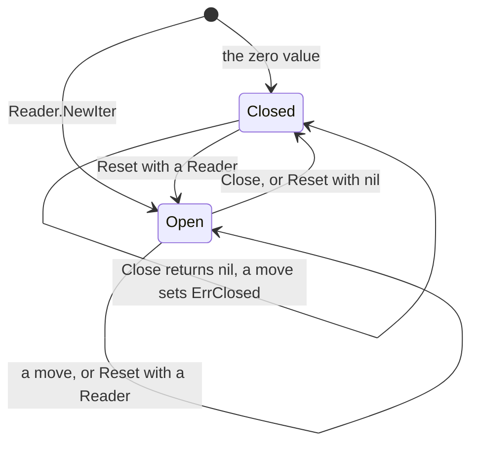

<!--
  ~ Copyright ThesmOS B.V. 2026
  ~ SPDX-License-Identifier: Apache-2.0
-->

# RFC-0087: Cursors That a Caller Keeps

## Summary

We propose that `Reader.NewIter` and `Reader.RangeDeletes` of `sstable` return
a new cursor that the caller keeps after `Close`. A new method `Reset` sets a
kept cursor on a Reader and keeps its buffers. A caller that keeps its cursors
then reads without an allocation, as the pool of cursors allows today. `Close`
of a closed cursor returns nil and does not change the cursor. A move of a
closed cursor reports false, and `Err` then returns `ErrClosed`. The zero value
of each cursor is a closed cursor. `Open`, `Get`, `MayContain`,
`MayContainPrefix` and `Span` take their cursors from the pools of the
package, because their cursors do not leave the call. Today `Close` puts the
cursor into a pool while the caller still has a pointer to it. A second
`Close` after another goroutine took the cursor from the pool releases the
blocks of that goroutine and puts the cursor into the pool twice.

## Motivation

The CI run of commit 6648f56 failed in its race tests. The race detector
reported this schedule of two specs that ran in parallel:

1. A spec closed a cursor, and `Close` put the cursor into the pool.
2. The spec closed the cursor again. The second `Close` read the Reader field
   of the cursor at `sstable/iter.go:355`.
3. The other spec called `Open`, which took the same cursor from the pool
   through `NewIter`. `NewIter` wrote the Reader field at
   `sstable/reader.go:762`.

The race detector reported the read and the write as unordered. In this run
the second `Close` read a nil Reader and returned nil. When `NewIter` writes
the field first, the second `Close` closes the cursor of `Open`.

The spec followed the contract of the package. By the contract of
`Iter.Close`, a second `Close` returns nil before another `NewIter` takes the
cursor from the pool. A caller cannot know whether another goroutine called
`NewIter` between the two calls. In a program with two goroutines that read
tables, every second `Close` is unsafe. `RangeDeleteIter.Close` has the same
contract.

When the other goroutine takes the cursor first, the second `Close` corrupts
the reads of that goroutine:

- It releases the references of that goroutine to a lent block and a lent
  partition. The count of references of the `Block` then falls to zero while
  the goroutine still reads it, and its buffer returns to the pool of its size
  class. The next block of that class overwrites the key and the value that
  the goroutine reads.
- It puts the cursor into the pool a second time. `NewIter` can then return
  the same cursor to two goroutines. Both goroutines move the cursor at once.

A move after `Close` is a defect of the same kind. It dereferences the nil
Reader of the cursor and panics. After another goroutine took the cursor, the
move changes the position of the cursor of that goroutine.

A second `Close` is ordinary Go. A caller that defers `Close` and also calls
it on the path that checks its error closes a cursor twice. `os.File.Close`
allows that pattern, because a second call returns an error and does not
change the file. `Merger.Close` closes every source that implements
`io.Closer`. It then closes a second time each cursor that the caller closed
before.

The pools of cursors also break the convention of Go and of the package:

- Go documents `sync.Pool` for temporary items that the clients of a package
  share without knowing it. The output buffers of `fmt` are its example.
  `bufio.Reader` and `flate.Writer` are reusable values of the standard
  library. Their callers keep them and call `Reset` to use them again.
- In `sstable` the caller keeps a `Writer`, a `Fragmenter` and a `Merger`, and
  calls `Reset` for the next table or merge. The cursors of a `Reader` are the
  values of the package that `Close` puts into a pool.

## Detailed design

### API

```go
package sstable

// NewIter returns a new cursor over the entries of the table under opts. The
// cursor is on no entry until a move. The caller keeps the cursor after
// Close. [Iter.Reset] sets it on another Reader.
//
// # Allocation contract
//
// NewIter allocates the cursor. The moves of the cursor allocate its buffers
// until they have grown to the largest block and partition that it reads.
func (r *Reader) NewIter(opts IterOptions) *Iter

// Reset sets the cursor on the table of r under opts and leaves it on no
// entry. It releases the references of the cursor to a block and a partition
// of a LendingCache, drops the bytes of its reads ahead and discards the
// error of Err. The cursor keeps its other buffers. A nil r leaves the cursor
// closed.
//
// # Allocation contract
//
// Zero-alloc.
func (it *Iter) Reset(r *Reader, opts IterOptions)

// Close releases the references of the cursor to a block and a partition of a
// LendingCache, drops the bytes of its reads ahead and returns the error of
// Err. The cursor keeps its other buffers for the next Reset. A move of a
// closed cursor reports false, and Err then returns ErrClosed. Close of a
// closed cursor returns nil and does not change the cursor.
//
// # Allocation contract
//
// Zero-alloc.
func (it *Iter) Close() error

// RangeDeletes returns a new cursor over the fragments of the range
// tombstones of the table. The cursor is on no position until a move. The
// caller keeps the cursor after Close. [RangeDeleteIter.Reset] sets it on
// another Reader.
//
// # Allocation contract
//
// RangeDeletes allocates the cursor. The moves of the cursor allocate its
// buffers until they have grown to the largest fragment partition.
func (r *Reader) RangeDeletes() *RangeDeleteIter

// Reset sets the cursor on the fragments of the table of r and leaves it on
// no position. It releases the reference of the cursor to a fragment
// partition of a LendingCache and discards the error of Err. The cursor keeps
// its buffers. A nil r leaves the cursor closed.
//
// # Allocation contract
//
// Zero-alloc.
func (it *RangeDeleteIter) Reset(r *Reader)

// Close releases the reference of the cursor to a fragment partition of a
// LendingCache. The cursor keeps its buffers for the next Reset. A move of a
// closed cursor reports false, and Err then returns ErrClosed. Close of a
// closed cursor does not change the cursor.
//
// # Allocation contract
//
// Zero-alloc.
func (it *RangeDeleteIter) Close()

// ErrClosed reports a call of Writer.Add, Writer.AddRangeDelete or
// [Writer.Close] after Close wrote the table, and a move of a closed [Iter]
// or [RangeDeleteIter]. It classifies as errs.Invalid.
var ErrClosed = errs.WithClass(errors.New("sstable: the writer or the cursor is closed"),
	errs.Invalid)
```

Each cursor starts with a field of this type:

```go
// noCopy makes go vet report a copy of a cursor. A copy shares the references
// of the cursor to lent blocks, so a Close of both copies releases a block
// twice.
type noCopy struct{}

// Lock does nothing. go vet reports a copy of a value whose pointer has the
// methods Lock and Unlock.
func (*noCopy) Lock() {}

// Unlock does nothing.
func (*noCopy) Unlock() {}
```

The signatures of `NewIter`, `RangeDeletes`, `Close` and the moves do not
change. `IterOptions` does not change.

### Lifecycle



`NewIter` and `Reset` with a Reader open a cursor. `Close` and `Reset` with nil
close it. While it is open, the cursor keeps its Reader and its references to
lent blocks. A closed cursor has neither. The collector can then free a Reader
that a closed cursor read. The buffer of each block that the cursor read
returns to its pool when the cache evicts the block.

### Rules

- `NewIter` allocates a cursor and sets it on the Reader as `Reset` does.
  `RangeDeletes` does the same for a cursor of fragments.
- `Reset` of an open cursor releases its references and discards its error. A
  caller that needs the error of a read checks `Err` or `Close` before it
  calls `Reset`.
- `Close` and `Reset` release each reference to a lent block or partition
  once. A second `Close` does not release a block.
- `Close` and `Reset` drop the bytes of the reads ahead, as `Close` drops them
  today. They keep the buffers of the blocks, of the partitions and of the
  keys of the cursor.
- A move of a closed cursor reports false and sets `ErrClosed`. A closed
  cursor is on no entry, so `Key`, `Value`, `Start` and `End` return nil and
  `Seq` returns 0. `Err` of a closed cursor returns nil until a move.
- The check for a closed cursor is one comparison with nil. `Next` and `Prev`
  of an open cursor within its current block do not make it.
- The key and the value of the current entry are valid until the next move,
  `Reset` or `Close` of the cursor.
- Only the goroutine of a cursor calls its moves, its `Reset` and its
  `Close`. Cursors of one Reader can move at once.
- The package puts into a pool only a cursor that it took from that pool.

### Cursors inside the package

`Open`, `Get`, `MayContain`, `MayContainPrefix` and `Span` take a cursor from
the pool of the package and set it with `Reset`. They close the cursor and put
it back into the pool before they return. `Open` takes a cursor of fragments
from its pool in the same way. Each call returns a value or a copy of the bytes
that it read:

| Call | Result |
|---|---|
| `Open` | A copy of the smallest key and of the start of the first fragment |
| `Get` | The value, appended to the `dst` of the caller |
| `MayContain`, `MayContainPrefix` | A bool |
| `Span` | A `Span` value |

These calls keep their allocation contracts. They do not allocate once the
pool has a cursor whose buffers have grown to the block and the partitions of
the call.

### Cost

We measured with Go 1.27.3 on an AMD Ryzen 9 9950X3D. Each run used one
processor under `b.Loop` for 200 ms, and each row has 6 runs. The table has
100,000 entries with values of 100 bytes in about 3,000 uncompressed data
blocks of 4 KiB. The Reader does
not have a cache. Each iteration seeks to a key in another block.

| Iteration | Median | Range | Allocations |
|---|---|---|---|
| `NewIter` from the pool, `SeekGE` and `Close` | 478.0 ns | 427.8 to 490.5 ns | 0 |
| `NewIter` of a new cursor and `SeekGE` | 1,151 ns | 1,135 to 1,176 ns | 4, 5,551 B |

A memory profile of the second row shows the allocations of the cursor, of the
buffer of its block and of the keys of its index cursor and its data cursor.

- The second row measures a seek through the proposed `NewIter`.
- A seek through a kept cursor calls `Reset`, `SeekGE` and `Close`. The first
  row measures those calls with the `Get` and the `Put` of the pool in
  addition. `Reset` was not measured.
- `unsafe.Sizeof` gives 600 bytes for an `Iter` and 552 bytes for a
  `RangeDeleteIter` on amd64. The allocator rounds them to its size classes of
  640 and 576 bytes. The field of `noCopy` takes 0 bytes.
- golangci-lint 2.15.0 with the configuration of core reports a copy of a
  struct with a `noCopy` field through the copylocks check of govet. It does
  not report anything else about the type.

### Invariants

1. The package puts into a pool only the cursors that it took from that pool.
2. Any sequence of calls of `Close` and `Reset` releases each reference of a
   cursor to a lent block or partition once.
3. A move of a closed cursor reports false and sets `ErrClosed`. It does not
   change another cursor.
4. `Reset`, `Close` and the moves of a kept cursor do not allocate once its
   buffers have grown to the largest block and partition that it reads.
5. `Open`, `Get`, `MayContain`, `MayContainPrefix` and `Span` allocate what
   they allocate today.

### Failure handling

| Condition | Result |
|---|---|
| A second `Close` | Returns nil and does not change the cursor |
| A move of a closed cursor | Reports false, and `Err` returns `ErrClosed` |
| A move of the zero value | Reports false, and `Err` returns `ErrClosed` |
| `Reset` of an open cursor | Releases its references, drops its bytes ahead and discards its error |
| `Reset` with a nil Reader | Closes the cursor and discards its error |
| A copy of a cursor | go vet reports it. A `Close` of both copies releases a lent block twice |
| A cursor that the caller never closes | The same as today: the cursor keeps its Reader and its lent blocks until the collector frees it |

### Tests

| # | Guarantee |
|---|---|
| 1 | Parallel specs under the race detector close a cursor twice while other goroutines open and move cursors of the same Reader. The second `Close` returns nil |
| 2 | `Close` and `Reset` release each lent block and each lent partition once. A `LendingCache` of the specs counts the releases of each `Block` |
| 3 | `assert.FailsAfterClose` checks each move of a closed cursor and of the zero value for `ErrClosed` |
| 4 | For every layout of the specs, a cursor that `Reset` sets on a second Reader yields the entries of that table |
| 5 | `NewIter` after a `Close` returns a cursor other than the closed one |
| 6 | A stateful machine with two clients runs `NewIter`, `Reset`, the moves, `Close` and a second `Close` on the tables of a shared `LendingCache`. Each move yields the entries of the model. After the last `Close`, each `Block` has only the reference of the cache |
| 7 | The allocation tests and the benchmarks state 0 allocations for `Reset`, `SeekGE` and `Close` of a kept cursor, 1 for `NewIter` and `RangeDeletes`, and the ceilings of today for `Get`, `MayContain`, `MayContainPrefix` and `Span` |
| 8 | The specs cover every statement, and dokimi-mutate-go with `--confirm` detects every mutant of the changed lines |

### Migration

The signatures do not change, so every caller compiles. These are the effects
on each kind of caller:

- A caller that takes a cursor for each read and closes it reads the same
  entries. It allocates the cursor and its buffers in each read.
- A caller that keeps its cursors and calls `Reset` for each read does not
  allocate once the buffers have grown.
- A caller that closes a cursor twice does not need a change.
- A caller that moves a cursor after `Close` gets `ErrClosed` in place of a
  panic.
- The code of `Merger` does not change. `Merger.Close` closes the cursors of a
  merge, and the caller sets them on the tables of the next merge with
  `Reset`. A caller can close a cursor of a merge before `Merger.Close`
  closes it again.

A read state that a caller reuses keeps its cursors by value, because the zero
value is a closed cursor:

```go
// maxTables is the most tables that one read of the engine merges.
const maxTables = 16

// readState is the state of one read of the engine. The cursors keep their
// buffers from one read to the next.
type readState struct {
	merge sstable.Merger
	iters [maxTables]sstable.Iter
	srcs  []sstable.Source
}

// open sets a cursor on each table of a read and merges the cursors. tables
// has at most maxTables Readers.
func (s *readState) open(tables []*sstable.Reader) {
	s.srcs = s.srcs[:0]
	for i, r := range tables {
		s.iters[i].Reset(r, sstable.IterOptions{})
		s.srcs = append(s.srcs, &s.iters[i])
	}
	s.merge.Reset(s.srcs)
}
```

`Merger.Close` at the end of the read closes every cursor, and the next `open`
sets them again. go vet reports a copy of a `readState`, because it contains
cursors.

Every caller of `NewIter` and `RangeDeletes` in core is in package `sstable`:
`Open`, `Get`, `MayContain`, `MayContainPrefix`, `Span` and the specs.

## Alternatives considered

### A. One Close, and a check in race builds

Pebble documents its `Iterator.Close` with this sentence: "It is not valid to
call any method, including Close, after the iterator has been closed." Its
`CloseChecker` panics on a second `Close` in builds with the tag `invariants`
or with the race detector. In other builds its `Close` is empty. zap marks a
pooled `CheckedEntry` at its `Write`. A second `Write` of the entry writes a
report to the error output of the entry.

**Why not:** a deferred `Close` with a second `Close` on the error path is
valid Go. `os.File` supports the pattern. A check in race builds finds the
defect only in a test that runs the schedule. A production build still
corrupts its reads. Core does not panic at run time. The package has also
released the contract that a second `Close` returns nil.

### B. A handle with a generation

`NewIter` would return a value of two fields: a pointer to a pooled cursor and
its generation. `Close` would raise the generation of the cursor before it puts
the cursor into the pool. Each method would compare the two generations with
an atomic load. A method of a stale handle would return at once.

**Why not:** every move adds an atomic load. A handle of 16 bytes allocates
each time a caller converts it to a `Source`, so a merge allocates per cursor.
The type of the result of `NewIter` changes, so every caller changes.

### C. An allocated handle over a pooled cursor

`NewIter` would allocate a handle of 8 bytes with a pointer to a cursor from
the pool. `Close` would put the cursor into the pool and clear the pointer. A
second `Close` would find a nil pointer and return.

**Why not:** each `NewIter` allocates the handle, so each read allocates at
least once. Each move loads the cursor through the handle. A handle that
keeps its cursor across `Close` and offers `Reset` is this proposal with a
second pointer. The verdict changes if callers cannot keep cursors between
reads. This alternative then costs one allocation of 8 bytes per read. A new
cursor costs 4 allocations with 5,551 bytes in total.

### D. Pooled buffers in a cursor that the caller keeps

`NewIter` would allocate the cursor and take its buffers from a pool. `Close`
would put the buffers into the pool and keep the cursor.

**Why not:** each `NewIter` allocates 640 bytes for the cursor. Alternative C
allocates 8 bytes. A caller that keeps a cursor gives its buffers back at each
`Close` and takes them from the pool again at each `Reset`.

### E. Serial specs for a second Close

The specs of a second `Close` would run without `t.Parallel`. Other specs then
do not take the cursor between the two calls.

**Why not:** the race tests pass, and every program with two goroutines that
read tables keeps the defect.

## Drawbacks

- A caller that takes a new cursor for each read allocates 4 objects with
  5,551 bytes in total per read. In the measurement each such seek takes about
  670 ns more. The cost ends when the caller keeps its cursors and calls
  `Reset`.
- Between reads a kept cursor keeps 640 bytes and the buffers of the largest
  block and partition that it read. With blocks of 4 KiB a kept cursor keeps
  about 5.5 KB. A block of one large value makes the buffers as large as
  the value.
- The collector drops the idle cursors of a pool. It does not drop the
  buffers of a kept cursor.
- The API gains `Iter.Reset` and `RangeDeleteIter.Reset`.
- Each cursor gains a field of 0 bytes. The package gains a type with two
  empty methods.
- The text of `ErrClosed` changes.
- A move makes one more comparison with nil, except `Next` and `Prev` of an
  open cursor within its current block.

## Open questions

None.

## Unresolved / future work

- This proposal does not bound the buffers of a kept cursor. `MaxRetained`
  bounds the buffers of a `Writer` in that way. A kept cursor keeps the
  buffers that a cursor of the pool keeps today. Pebble drops a key buffer of
  4 KB or more when it puts the state of an iterator into its pool. The
  verdict changes when a caller measures the memory of kept cursors over
  tables with large values.
- A `Block` of a `LendingCache` counts its references. A second `Release` of
  one reference is a defect that the package does not detect. This proposal
  does not change `Block`.

## References

- The CI run of commit 6648f56:
  <https://github.com/thesm-os/core/actions/runs/41711162778>.
- Go 1.27.3, `sync/pool.go`: the fit of a `Pool`.
- Go 1.27.3, `sync/cond.go`: `noCopy` and the copylocks check of go vet.
- Go 1.27.3, `bufio/bufio.go` and `compress/flate/deflate.go`: `Reset` of a
  `Reader` and of a `Writer`.
- Go 1.27.3, `os/file_posix.go`: a second `Close` of a `File`.
- Pebble at a995e890c06e, `iterator.go`: `Iterator.Close` and
  `maxKeyBufCacheSize`:
  <https://github.com/cockroachdb/pebble/blob/a995e890c06e/iterator.go>.
- Pebble at a995e890c06e, `internal/invariants/on.go` and `off.go`:
  `CloseChecker`.
- zap at 4892335e05f1, `zapcore/entry.go`: `CheckedEntry`:
  <https://github.com/uber-go/zap/blob/4892335e05f1/zapcore/entry.go>.
- RFC-0062, sorted tables and memtables for LSM trees.
- RFC-0071, a bounded workspace for a table writer.
- RFC-0072, read-ahead of a table cursor.
- RFC-0075, blocks that a cache lends to readers.
- RFC-0078, range tombstones and prefix filters of a table.
