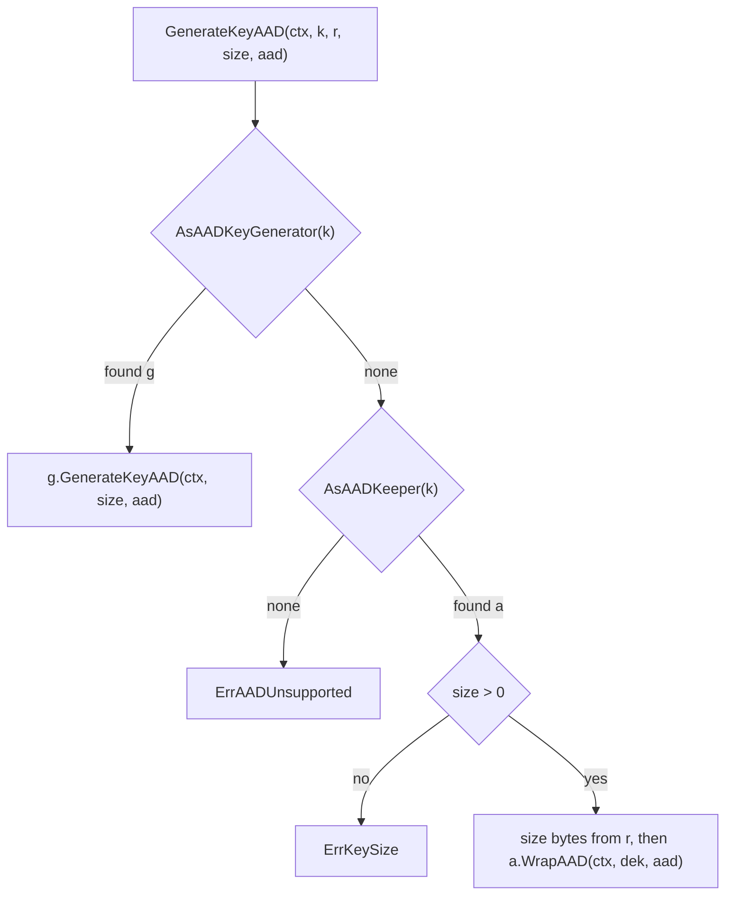

<!--
  ~ Copyright ThesmOS B.V. 2026
  ~ SPDX-License-Identifier: Apache-2.0
-->

# RFC-0088: Data Keys That a Custodian Generates with Associated Data

## Summary

We propose an optional capability `crypto.AADKeyGenerator` of a `Keeper`, the
function `crypto.AsAADKeyGenerator` that finds it, and the function
`crypto.GenerateKeyAAD`. A custodian with the capability generates a data key
and binds associated data to its wrapped copy in one call. `GenerateKeyAAD`
takes that path when the custodian offers it, as `crypto.GenerateKey` takes
the path of `KeyGenerator`. Otherwise it reads the key from the random source
of the caller and wraps it with `AADKeeper.WrapAAD`. A `Keeper` without an
`AADKeeper` returns the new error `crypto.ErrAADUnsupported`.
`localkey.Keeper` implements the capability.

## Motivation

`KeyGenerator` and `AADKeeper` are two optional capabilities of a `Keeper`,
and no call combines them:

- `KeyGenerator.GenerateKey` takes no associated data. `AADKeeper` has no call
  that generates a key.
- The docblock of `KeyGenerator` calls the generation at the custodian the
  stronger path, because the data key comes from the entropy source of the
  custodian. `crypto.GenerateKey` takes that path whenever the custodian
  offers it. Its wrapped copy does not bind associated data.
- `localkey.Keeper` implements both capabilities. Its `UnwrapAAD` refuses the
  wrapped copy of `GenerateKey` with associated data of one byte or more, and
  its `Unwrap` unwraps that copy.

A caller that binds associated data to each wrapped key reads the key from
its own random source and wraps it with `WrapAAD`. The key then comes from
the entropy of the caller, also when the custodian generates keys. A caller
that takes the key from the custodian gives up the binding. A wrapped key that
a store moves to the place of another object then still unwraps.

The custodians differ:

- AWS KMS generates a data key in `GenerateDataKey` and binds an encryption
  context to the encrypted copy. A `Decrypt` with another context fails with
  `InvalidCiphertextException`.
- The Transit secrets engine of HashiCorp Vault takes associated data on
  `encrypt` and not on `datakey`.

## Detailed design

### API

```go
package crypto

// AADKeyGenerator is the optional capability of a custodian that generates
// a data key internally and binds associated data to its wrapped copy, as
// AWS KMS binds an encryption context in GenerateDataKey. The data key
// comes from the entropy source of the custodian, as for [KeyGenerator].
type AADKeyGenerator interface {
	AADKeeper

	// GenerateKeyAAD returns a fresh data key of size bytes, both in the
	// clear and wrapped under the key of this Keeper with aad bound to the
	// wrapped copy. UnwrapAAD with the same aad unwraps it. Callers that
	// only encrypt should zero plaintext as soon as the payload is sealed.
	//
	// A non-positive size is an error.
	GenerateKeyAAD(ctx context.Context, size int, aad []byte) (plaintext, wrapped []byte, err error)
}

// AsAADKeyGenerator returns the first [AADKeyGenerator] in the chain that
// starts at k and follows each decorator's UnwrapKeeper() Keeper, and
// reports whether it found one. It follows the rules of [AsDestroyer].
//
// # Allocation contract
//
// Zero alloc.
func AsAADKeyGenerator(k Keeper) (AADKeyGenerator, bool)

// GenerateKeyAAD returns a fresh data key of size bytes, in the clear and
// wrapped under k with aad bound to the wrapped copy. UnwrapAAD of the
// AADKeeper of k with the same aad unwraps the copy.
//
// When [AsAADKeyGenerator] finds an [AADKeyGenerator] in k, the custodian
// generates the key and r is not read. Otherwise GenerateKeyAAD reads size
// bytes from r and wraps them with [AADKeeper.WrapAAD] of the AADKeeper that
// [AsAADKeeper] finds in k.
//
// Returns [ErrAADUnsupported] for a k without an AADKeeper, [ErrKeySize]
// for a non-positive size on the r path, and the custodian's own error on
// the AADKeyGenerator path. An error from r or from WrapAAD is returned as
// it is. No key material accompanies an error, because GenerateKeyAAD
// zeroes the bytes that it read before it returns.
//
// # Allocation contract
//
// On the r path, one allocation for plaintext plus whatever WrapAAD
// allocates. On the AADKeyGenerator path, whatever the custodian allocates.
func GenerateKeyAAD(ctx context.Context, k Keeper, r rand.Rand, size int, aad []byte) (
	plaintext, wrapped []byte, err error)

// ErrAADUnsupported is returned by [GenerateKeyAAD] for a [Keeper] without
// an [AADKeeper]. Classifies as Unsupported: the Keeper does not bind
// associated data, and a retry fails in the same way.
var ErrAADUnsupported = errs.WithClass(errors.New("crypto: the keeper does not bind associated data"),
	errs.Unsupported)
```

### The paths of GenerateKeyAAD



### Rules

- `AADKeyGenerator` embeds `AADKeeper` and not `KeyGenerator`. A custodian
  that binds associated data to a generated key unwraps the copy through
  `UnwrapAAD`, so it implements `AADKeeper`. `KeyGenerator` remains a
  capability of its own.
- The interface has 6 methods: the 3 of `Keeper`, the 2 of `AADKeeper` and
  `GenerateKeyAAD`.
- `GenerateKeyAAD` checks `AADKeyGenerator` first, then `AADKeeper`, then the
  size. An empty `aad` on the r path still needs an `AADKeeper`, because the
  wrapped copy unwraps through `UnwrapAAD`. A caller without associated data
  calls `GenerateKey`.
- With an empty `aad`, `Unwrap` unwraps the wrapped copy, as `AADKeeper`
  states for `WrapAAD`.
- A Keeper that `KeyCreator.CreateKey` or `OpenKey` returns implements every
  optional capability of its `KeyCreator`, and `AADKeyGenerator` is one of
  them.
- `crypto.GenerateKey` does not change. It takes the path of `KeyGenerator`.

### Implementations in core

- `localkey.Keeper` implements `AADKeyGenerator`. `GenerateKeyAAD` reads
  size bytes from the random source of `New` and wraps them with `WrapAAD`.
  `GenerateKey` is `GenerateKeyAAD` with empty `aad`. Both zero the data key
  when the source or the wrap fails.
- A Keeper of `crypto/kek` implements neither `AADKeeper` nor
  `AADKeyGenerator`, and it has no `UnwrapKeeper`. The envelope of each data
  key that it wraps binds the key ID of its KEK. `GenerateKeyAAD` returns
  `ErrAADUnsupported` for it, and a caller of the package calls
  `GenerateKey`.
- An adapter over AWS KMS maps `GenerateKeyAAD` to `GenerateDataKey` with the
  associated data in the encryption context. An adapter over the Transit
  engine of Vault implements `AADKeeper` alone, so `GenerateKeyAAD` reads the
  key from r there.

### Kit

`coretest/cryptotest` gains `AssertAADKeyGeneratorContract(tb assert.TB, g
crypto.AADKeyGenerator)`, which requires:

- A second call of `GenerateKeyAAD` with the same `aad` returns another data
  key.
- A data key has the requested size.
- `UnwrapAAD` with the same `aad` returns the data key.
- `UnwrapAAD` with other `aad` or with empty `aad`, and `Unwrap`, return an
  error for the wrapped copy.

`AssertKeyCreatorContract` requires `AADKeyGenerator` of a created Keeper when
the creator has it. dokimi generates the stubs `AADKeeperStub` and
`AADKeyGeneratorStub` in `cryptotest`, as it generates `KeyGeneratorStub`.

### Invariants

1. The wrapped copy of `GenerateKeyAAD` unwraps through `UnwrapAAD` with the
   same `aad` to the plaintext that the call returned.
2. `UnwrapAAD` with other `aad` returns an error for the copy, and never a
   wrong key.
3. The path of the custodian does not read the random source of the caller.
4. No key material accompanies an error of `GenerateKeyAAD`.
5. `AsAADKeyGenerator` does not allocate, and the r path allocates the
   plaintext beside what `WrapAAD` allocates.

### Failure handling

| Condition | Result |
|---|---|
| A Keeper without an `AADKeeper` | `ErrAADUnsupported` |
| A non-positive size on the r path | `ErrKeySize` |
| A non-positive size at the custodian | The error of the custodian, `ErrKeySize` for `localkey` |
| An error of r | Returned as it is, and the bytes that r wrote are zeroed |
| An error of `WrapAAD` | Returned as it is, and the data key is zeroed |
| A destroyed key of `localkey` | `ErrKeyDestroyed` |
| `UnwrapAAD` with other `aad` | An error, and never a wrong key |

### Tests

| # | Guarantee |
|---|---|
| 1 | `AsAADKeyGenerator` finds the capability behind decorators, and reports false for a Keeper without it and behind a decorator without `UnwrapKeeper` |
| 2 | `GenerateKeyAAD` returns the key of an `AADKeyGenerator` without a read of r, also behind a decorator |
| 3 | `GenerateKeyAAD` over an `AADKeeper` wraps the bytes of r with `WrapAAD` and passes `aad` |
| 4 | `GenerateKeyAAD` returns `ErrAADUnsupported` for a Keeper without an `AADKeeper` |
| 5 | `GenerateKeyAAD` returns `ErrKeySize` for every non-positive size on the r path |
| 6 | An error of r or of `WrapAAD` returns no key, and the bytes that r wrote are zeroed |
| 7 | `localkey` passes `AssertAADKeyGeneratorContract` |
| 8 | `localkey` returns `ErrKeySize`, the error of its source and `ErrKeyDestroyed` from `GenerateKeyAAD` |
| 9 | `AssertAADKeyGeneratorContract` fails for a custodian that binds no `aad` to a generated key |
| 10 | The allocation tests and the benchmarks state 0 allocations for `AsAADKeyGenerator` and 1 for the r path |
| 11 | The specs cover every statement, and dokimi-mutate-go with `--confirm` detects every mutant of the changed lines |

### Migration

A caller that binds associated data and reads its keys from its own source
calls `GenerateKeyAAD` in place of its read and `WrapAAD`. It then takes the
key from the custodian whenever the custodian offers the capability. The
proposal adds API alone, so the callers of the other calls do not change.

## Alternatives considered

### A. Associated data on KeyGenerator

`KeyGenerator.GenerateKey` would take `aad` as a third parameter.

**Why not:** every implementation of `KeyGenerator` changes, and a custodian
that generates keys without a binding, such as the `datakey` of Vault, can
no longer implement the capability.

### B. GenerateKeyAAD on AADKeeper

`AADKeeper` would gain the method `GenerateKeyAAD`.

**Why not:** Vault binds associated data on a wrap and does not generate keys
with it. An adapter over Vault could then no longer implement `AADKeeper`,
because every `AADKeeper` would have to generate keys.

### C. The function alone

`GenerateKeyAAD` would read the key from r and call `WrapAAD`, without a
capability.

**Why not:** the key never comes from the entropy of the custodian, which
the docblock of `KeyGenerator` calls the stronger path.

### D. GenerateKey for an empty aad

`GenerateKeyAAD` with empty `aad` would call `GenerateKey` for a Keeper
without an `AADKeeper`.

**Why not:** the contract of the function binds `aad`, and the copy of such
a Keeper unwraps through `Unwrap` alone. A caller without associated data
calls `GenerateKey` itself.

## Drawbacks

- A `Keeper` has five optional capabilities, and a decorator of a Keeper keeps
  `UnwrapKeeper` so that `AsAADKeyGenerator` finds the capability behind it.
- A custodian that implements both `KeyGenerator` and `AADKeyGenerator`
  implements two calls that generate keys.
- `crypto` gains one more sentinel, and `cryptotest` two generated stubs.

## Open questions

None.

## Unresolved / future work

- A Keeper of `crypto/kek` does not bind the associated data of a caller.
  This proposal does not add `AADKeeper` to it.
- This proposal has no capability that returns the wrapped copy alone, as
  `GenerateDataKeyWithoutPlaintext` of AWS KMS does.

## References

- Issue 119, <https://github.com/thesm-os/core/issues/119>.
- AWS KMS, GenerateDataKey:
  <https://docs.aws.amazon.com/kms/latest/APIReference/API_GenerateDataKey.html>.
- HashiCorp Vault, the API of the Transit secrets engine:
  <https://developer.hashicorp.com/vault/api-docs/secret/transit>.
- RFC-0018, key custody.
- RFC-0042, intermediate key-encryption keys.
